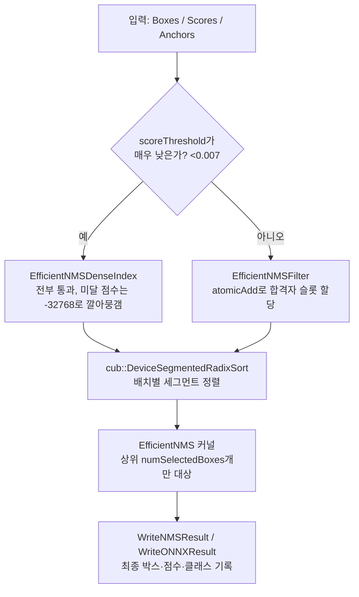

# TensorRT EfficientNMS 플러그인 — 구조와 동작 원리

> 출처: [NVIDIA/TensorRT](https://github.com/NVIDIA/TensorRT) — `plugin/efficientNMSPlugin/` (Apache-2.0)
> 대상 버전: `main` 브랜치 기준 (EfficientNMS_TRT는 TensorRT 10.12부터 deprecated, 후속은 `INMSLayer`)

---

## 1. 개요

EfficientNMS는 객체 검출 네트워크의 후처리 단계인 NMS(Non-Maximum Suppression)를 GPU에서 빠르게 수행하도록 만든 TensorRT 플러그인이다. 핵심 아이디어는 **"불필요한 계산을 최대한 빨리 걸러내고, 남은 소수의 후보에만 비싼 연산(정렬·IOU 비교·활성화 함수)을 집중시키는 것"**이다.

전체 처리는 세 단계로 나뉜다.

1. **Filter** — 점수 임계값(`scoreThreshold`) 미달 후보를 제거
2. **Sort** — 남은 후보를 점수 내림차순 정렬
3. **NMS** — 상위 후보(`numSelectedBoxes`, 기본 4096개)만 대상으로 IOU 억제 수행

---

## 2. 파일 구성

```
plugin/efficientNMSPlugin/
├── efficientNMSPlugin.h / .cpp   TensorRT 플러그인 인터페이스 구현 (IPluginV2DynamicExt)
├── efficientNMSParameters.h      파라미터 구조체 정의
├── efficientNMSInference.h       추론 진입점 함수 선언
├── efficientNMSInference.cuh     박스 좌표 구조체 + 정밀도별 산술 헬퍼
└── efficientNMSInference.cu      실제 CUDA 커널 구현체
```

`efficientNMSPlugin.cpp`는 TensorRT 엔진이 호출하는 `getWorkspaceSize()`, `enqueue()` 등 표준 인터페이스만 구현하고, 실제 로직은 전부 `efficientNMSInference.cu`의 함수로 위임하는 얇은 래퍼(wrapper)다.

---

## 3. 핵심 자료구조

### 3.1 EfficientNMSParameters

플러그인 동작을 제어하는 단일 파라미터 구조체. 크게 세 그룹으로 나뉜다.

| 그룹 | 필드 | 기본값 | 의미 |
|---|---|---|---|
| NMS 옵션 | `iouThreshold` | 0.5 | IOU 억제 임계값 |
| | `scoreThreshold` | 0.5 | 점수 필터링 임계값 |
| | `numOutputBoxes` | 100 | 이미지당 최종 출력 박스 수 |
| | `backgroundClass` | -1 | 배경 클래스 ID (없으면 -1) |
| | `classAgnostic` | false | 클래스 무관 NMS 여부 |
| | `boxCoding` | 0 | 0=BoxCorner, 1=BoxCenterSize |
| NMS 내부 동작 | `numSelectedBoxes` | **4096** | 본선에 올릴 상위 후보 수 (하드코딩된 상수) |
| | `scoreBits` | -1 | 점수를 정수 비트로 패킹해 정렬을 가속하는 옵션 |
| | `outputONNXIndices` | false | ONNX NMS 표준 방식(인덱스만 출력)으로 낼지 여부 |
| 텐서 구성 | `batchSize`, `numClasses`, `numAnchors` 등 | - | 런타임에 자동 설정됨 |

### 3.2 박스 표현 — `BoxCorner<T>` / `BoxCenterSize<T>`

두 좌표계(코너 `y1,x1,y2,x2` / 중심-크기 `y,x,h,w`)를 각각 템플릿 구조체로 정의하고, 서로 형변환 연산자로 자유롭게 변환한다. 각 구조체는 다음 멤버 함수를 갖는다.

- `reorder()` — y1<y2, x1<x2가 되도록 좌표 스왑
- `clip(low, high)` — 좌표를 [0,1] 범위 등으로 클리핑
- `area()` — 넓이 계산 (IOU에 사용)
- `intersect(a, b)` — 두 박스의 교집합 영역
- `decode(anchor)` — 앵커 좌표 기준 보정값을 실제 좌표로 디코딩

**IOU 계산은 좌표계와 무관하게 항상 `BoxCorner`로 변환한 뒤 수행된다.**

### 3.3 정밀도 독립 연산 헬퍼

FP32/FP16을 같은 커널 코드로 처리하기 위해 `add_mp`, `sub_mp`, `sigmoid_mp` 등 "정밀도 무관(mixed-precision)" 함수를 별도로 정의한다. GPU 아키텍처가 `SM 5.3` 미만이면 FP16 네이티브 연산이 없으므로, float로 변환 → 연산 → half로 재변환하는 fallback 경로를 자동 선택한다.

---

## 4. 전체 실행 파이프라인



호출 순서는 `EfficientNMSInference → EfficientNMSDispatch → (Filter/DenseIndex 선택) → Sort → EfficientNMSLauncher(메인 커널)` 순이다.

---

## 5. 단계별 상세

### 5.1 Filter — "번호표 뽑기" 방식

`EfficientNMSFilter` 커널은 점수 하나당 스레드 하나를 배정한다. `scoreThreshold` 이상이면 `atomicAdd`로 자기 이미지의 카운터(`topNumData[imageIdx]`)를 올리고, 그 반환값을 자신의 저장 슬롯 번호로 사용한다.

- 합격자가 동시에 슬롯을 요청하므로, **합격자 수가 많을수록 atomic 경쟁이 심해져 병목이 된다.**
- `backgroundClass`에 해당하는 클래스는 이 단계에서 걸러진다.

### 5.2 DenseIndex — 저임계값 대체 경로

`scoreThreshold < 0.007`이면 위 병목을 피하기 위해 `EfficientNMSDenseIndex`로 전환된다. 이 커널은 **필터링을 하지 않고 모든 요소를 그대로 통과**시키되, 탈락 대상 점수를 `-32768`(사실상 -∞)로 덮어써 버린다. 다음 단계인 정렬에서 이 값들이 자동으로 맨 뒤로 밀려나므로, atomic 연산 없이 동일한 효과를 얻는다.

### 5.3 정렬 — CUB 세그먼트 Radix Sort

```cpp
cub::DeviceSegmentedRadixSort::SortPairsDescending(...)
```

배치(이미지)마다 독립된 "구간(segment)"으로 나눠 한 번의 호출로 전체 배치를 동시에 정렬한다. `scoreBits > 0`이면 정렬 대상 비트 수를 10비트로 제한해(양자화된 점수 패킹) radix sort 자체를 더 빠르게 만든다.

### 5.4 메인 NMS 커널 — 타일링 + 상태 방송(broadcast) 구조

`EfficientNMS` 커널은 그리드를 `(1, batchSize)`로 잡아 **이미지 1장 = 스레드블록 1개**로 배정한다. 후보 수가 스레드 수보다 많을 수 있으므로, `NMS_TILES = 5`로 정의해 스레드 하나가 최대 5개 후보("타일")까지 담당한다.

동작 순서:

1. 점수 순으로 정렬된 후보를 `i = 0, 1, 2, ...` 순서로 순회한다.
2. `i`번째 후보를 맡은 스레드(리더)가 판정 결과를 공유 변수 `blockState`에 기록해 블록 내 모든 스레드에 방송한다.
   - **`1` (생존)**: 이 후보는 합격 확정. 아직 살아있는 다른 스레드들은 이 후보와 IOU를 비교해야 함
   - **`-1` (이미 탈락)**: 이번 라운드는 아무 계산도 필요 없음 → 스킵
   - **`-2` (조기 종료)**: 합격 정원(`numOutputBoxes`)이 이미 채워짐 → 블록 전체 루프 탈출
3. 아직 살아있는 스레드만 방송된 후보와 `IOU()`를 계산하고, `iouThreshold` 이상이면 자신을 탈락(`-1`) 처리한다.
4. **한 번 탈락한 스레드는 이후 어떤 라운드에서도 다시 IOU를 계산하지 않는다.** 이것이 "비교 횟수를 크게 줄이는" 핵심 최적화다.

`classAgnostic`이 `false`면 IOU 비교 자체를 "같은 클래스일 때만" 수행하도록 조건이 하나 더 걸린다.

### 5.5 결과 기록

합격이 확정되는 순간 `WriteNMSResult`(표준 모드) 또는 `WriteONNXResult`(ONNX 인덱스 모드)가 호출된다.

- `scoreSigmoid`가 켜져 있으면 **이 시점에만** sigmoid를 적용 (전체 후보가 아닌 최종 합격자에게만 적용해 계산량 절감)
- `clipBoxes`가 켜져 있으면 좌표를 `[0,1]`로 클리핑
- ONNX 모드는 `(batch_index, class_index, box_index)` 3개 값만 기록하고, 남는 슬롯은 `PadONNXResult` 커널이 마지막 유효 값으로 패딩

---

## 6. 워크스페이스 메모리 레이아웃

`EfficientNMSWorkspaceSize()`가 다음을 모두 256바이트 정렬 기준으로 합산해 필요한 총 메모리 크기를 미리 계산한다.

| 버퍼 | 개수 | 용도 |
|---|---|---|
| 카운터 배열 | `(3 + 1 + numClasses) × batchSize` | 필터링용 3개, 출력 인덱싱용 1개, 클래스별 최대 개수 제한용 |
| int 버퍼 | 4종 (`topIndex`, `topClass`, `topAnchors`, `sortedIndex`) | 각 `batchSize × numScoreElements` |
| float 버퍼 | 2종 (`topScores`, `sortedScores`) | 각 `batchSize × numScoreElements` |
| 정렬 임시 버퍼 | CUB가 요구하는 크기 | `cub::DeviceSegmentedRadixSort` 내부 작업용 |

TensorRT는 엔진 빌드 시점에 이 크기만큼 GPU 메모리를 한 번에 확보해두므로, **추론 중에는 malloc/free가 전혀 발생하지 않는다.**

---

## 7. TensorRT 플러그인 인터페이스 연동

`efficientNMSPlugin.h`는 `IPluginV2DynamicExt`를 상속받아 다음을 구현한다.

- `getWorkspaceSize(...)` → `EfficientNMSWorkspaceSize()` 호출
- `enqueue(...)` → `EfficientNMSInference()` 호출 (FP32/FP16 분기 후 `EfficientNMSDispatch<T>` 실행)
- `clone()`, `configurePlugin()` 등 표준 TensorRT 플러그인 생명주기 메서드

즉 플러그인 래퍼는 "TensorRT 엔진과 실제 CUDA 커널을 연결하는 어댑터" 역할만 하고, 알고리즘 자체는 순수하게 `efficientNMSInference.cu`에 담겨 있다.

---

## 8. 설계 핵심 요약

| 최적화 포인트 | 구현 방식 |
|---|---|
| 필터링 병목 회피 | threshold가 매우 낮을 때 atomic 방식 대신 "점수를 -∞로 깔아뭉개고 정렬에 맡기는" DenseIndex 경로로 자동 전환 |
| 정렬 가속 | 배치 단위 세그먼트 Radix Sort + 선택적 비트 패킹(`scoreBits`) |
| 비교 횟수 감소 | 상위 4096개로 후보 수를 먼저 제한 + 한 번 탈락한 스레드는 재비교하지 않음 |
| 연산량 절감 | sigmoid 활성화를 최종 합격자에게만 적용 |
| 메모리 안정성 | 워크스페이스 크기를 빌드 시점에 전량 계산해 런타임 동적 할당 제거 |

---

## 참고 자료

- [efficientNMSPlugin README](https://github.com/NVIDIA/TensorRT/blob/main/plugin/efficientNMSPlugin/README.md)
- [efficientNMSInference.cu (소스)](https://github.com/NVIDIA/TensorRT/blob/main/plugin/efficientNMSPlugin/efficientNMSInference.cu)
- [efficientNMSParameters.h (소스)](https://github.com/NVIDIA/TensorRT/blob/main/plugin/efficientNMSPlugin/efficientNMSParameters.h)
