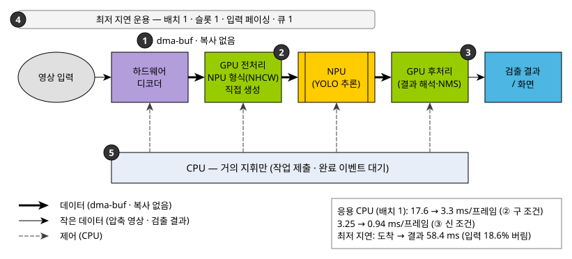

# NPU 기반 YOLO 추론에서 호스트 CPU를 최소화하는 기술
## — 최저 지연 운용을 기준으로

**Minimizing Host CPU Load in NPU-Based YOLO Inference — Techniques for the Lowest-Latency Operating Point**

저자: `[작성 필요]`

---

## 요약

NPU(신경망 처리 장치)가 YOLO 추론을 맡아도 영상 디코드, 입력 형식 변환, 결과 해석, 버퍼 복사는 여전히 호스트 CPU에 남는다.
본 원고는 Raspberry Pi 5 계열 보드와 외장 Hailo-8 NPU에서 이 일을 CPU 밖으로 옮긴 다섯 가지 기술을 거시적으로 정리한다.
운용 기준은 처리량(FPS)이 아니라 **최저 지연**이다. 배치 1에서 응용의 CPU 시간은 형식 변환을 GPU로 옮겨 프레임당 17.6 ms에서 3.3 ms로,
결과 해석까지 옮겨 다시 3.25 ms에서 0.94 ms로 줄었다(두 단계는 측정 조건이 다르다).
최저 지연 운용점에서 프레임 도착부터 검출 결과까지는 평균 58.4 ms였다(처리하지 못한 입력 18.6%는 버림).

## 1. 문제

추론 하나만 빠르면 실시간 검출이 되는 것은 아니다. 스마트폰과 서버에서도 추론 바깥의 전·후처리와 데이터 이동이 종단간 성능을 좌우한다고 보고되었다 \[1\][^r1], \[2\][^r2].
한 프레임은 디코드 → 크기·색·형식 변환 → 추론 → 결과 해석(박스 복원과 중복 제거, NMS) → 표시를 거친다.
이 중 추론만 NPU가 맡고 나머지를 CPU가 하면, CPU가 프레임마다 수 MB의 데이터를 읽고 쓴다.
대상은 Raspberry Pi Compute Module 5 \[3\][^r3]에 PCIe로 Hailo-8을 붙이고 HailoRT 4.24.0 \[4\][^r4]으로 YOLO11m \[5\][^r5]을 돌리는 구성이다(같은 계열 구성의 선행 사례 \[6\][^r6], \[7\][^r7]).
본 연구의 출발점에서는 배치 1로 처리할 때 응용의 CPU 시간이 프레임당 17.6 ms였다. 한 코어를 40% 넘게 쓰는 양이다.
목표는 이 CPU 개입을 최소화하되, 지연이 가장 짧은 운용 방식에서 그렇게 하는 것이다.

## 2. 주요 기술

그림 1은 다섯 기술이 파이프라인의 어디에 작용하는지 보여 준다. 핵심 원칙은 **데이터는 전용 하드웨어끼리 직접 주고받고, CPU는 거의 지휘만 한다**는 것이다.

**① 하드웨어 디코더와 제로 카피.** 영상은 SoC의 HEVC 하드웨어 디코더가 푼다. 디코드된 프레임은 CPU 메모리로 복사하지 않고,
리눅스의 버퍼 공유 방식인 dma-buf(장치끼리 같은 메모리를 파일 기술자로 넘기는 방식) \[8\][^r8]로 GPU에 바로 넘긴다. 디코더는 FFmpeg \[9\][^r9]의 하드웨어 경로로 부른다.
소프트웨어 디코드는 프레임당 CPU 시간 약 32 ms를 쓰지만, 하드웨어 디코더의 출력을 dma-buf로 그대로 받으면 0.23~0.28 ms다.
출력을 CPU 메모리로 내려받기만 해도 약 3.6배 비싸진다(명령행 도구 기준 2.0 대 0.55 ms).

**② NPU가 원하는 형식을 GPU가 바로 만든다.** NPU는 칩 내부용 입력 배치(NHCW, 행마다 채널을 나눠 늘어놓는 형식)를 쓴다.
일반적인 영상 배치(NHWC)로 넘기면 NPU 런타임이 CPU에서 내부적으로 형식을 바꾼다. 그래서 Vulkan \[10\][^r10] 전처리 셰이더가 GPU(V3D \[11\][^r11])에서 처음부터 NHCW로 쓰게 했다.
비용의 원인은 바꾸는 연산이 아니라, CPU가 캐시되지 않는 GPU 메모리를 한 바이트씩 읽는 데 있었다. 같은 형태의 전치 루프를 단독으로 재면 일반 메모리에서 0.95 ms, GPU 메모리에서 12.7 ms였다.
이 기술 하나로 배치 1의 응용 CPU가 프레임당 17.6 ms(dma-buf 입력이면 17.4 ms)에서 3.3 ms로 줄었다.

**그림 1.** CPU 최소화 기술의 전체 구조. 굵은 실선은 dma-buf로 복사 없이 넘기는 데이터, 가는 실선은 CPU를 거치는 작은 데이터(압축 영상, 최종 검출),
점선은 CPU의 제어다. ①~⑤는 본문의 기술 번호다.

**③ 결과 해석도 GPU에서.** NPU 런타임이 CPU에서 하던 결과 해석(원시 출력의 박스 복원과 NMS)을 GPU 셰이더로 옮겼다.
NPU의 원시 출력도 dma-buf로 GPU에 바로 넘기고, CPU는 최종 검출 몇 개만 받는다. GPU의 NMS는 CPU 기준 구현과 같은 결과를 내도록 맞췄고,
NPU 런타임의 NMS와는 비트까지 같지는 않지만 검출이 거의 같다(IoU 0.9 기준 매칭 0.999).
배치 1/슬롯 1에서 응용 CPU가 프레임당 3.25 ms에서 0.94 ms로 줄었고, 지연은 그대로였다(79.1 대 79.2 ms).

**④ 최저 지연 운용: 한 번에 한 장, 줄 세우지 않는다.** 한 번에 한 프레임만 추론하고(배치 1), 동시에 처리 중인 프레임도 하나로 둔다(슬롯 1).
입력은 카메라처럼 소스 시각에 맞춰 도착시키고(입력 페이싱), 대기열은 한 칸만 두어 처리하지 못한 프레임은 버린다.
페이싱 없이 재면 디코드 끝 기준 79 ms의 절반 넘게(약 42 ms, 추정)가 앞서 읽은 프레임이 슬롯을 기다린 대기였다.
입력 페이싱으로 이 대기를 없애면 도착 기준 평균 58.4 ms가 되며, 그 안에 입력 대기열 대기 약 14.5 ms가 남고, 입력의 18.6%는 버린다.

**⑤ CPU는 거의 지휘만 한다.** CPU는 큰 데이터를 만지지 않고 작업 제출과 완료 확인만 한다. 완료도 일정 간격으로 확인하는 대신 완료 이벤트로 깨어나 기다린다.
①~⑤를 모두 적용한 최저 지연 운용점에서 응용 CPU는 처리한 프레임당 약 1.0 ms였다(감소의 대부분은 ②·③의 몫이다).

## 3. 결과

**표 1.** 배치 1 기준 기술별 응용 CPU 시간과 최저 지연 운용점

| 구성 | 응용 CPU (ms/프레임) | 지연 |
|---|---:|---:|
| 출발점: 형식 변환·NMS를 CPU에서 | 17.6 | – |
| ② NPU 형식(NHCW)을 GPU가 직접 생성 | 3.3 | – |
| ③ 결과 해석(NMS 포함)을 GPU로 | 0.94 (직전 3.25) | 79.2 ms (디코드 끝 기준) |
| ④⑤ 최저 지연 운용(입력 페이싱 + 대기열 1) | 약 1.0 | **58.4 ms (도착 기준)**, 화면까지 70.2 ms |

> 출처 \[12\][^r12]. 1~2행은 GPU 960 MHz·디코더 자동 스레드·배치 1/슬롯 2(1,816프레임 3회 중앙값), 3~4행은 GPU 1150 MHz·디코더 1스레드·배치 1/슬롯 1(900프레임 3회 중앙값) 조건이다. 3행의 "직전"은 같은 조건에서 NMS를 CPU에 둔 값이다.
> 4행의 CPU는 처리한 프레임 기준이라 다른 행과 직접 비교하지 않고, 3·4행의 지연은 기점이 달라(디코드 끝 대 소스 도착) 서로 빼지 않는다.
> 4행의 58.4 ms와 CPU는 표시 없이 입력 18.6%를 버린 실행이고, 70.2 ms는 화면 표시를 켠 별도 실행(스왑체인 경로, 버림 19.1%)이다.

검출 결과는 기준 경로와 검출 수가 같았다(1,816프레임에서 9,457개). 측정 조건과 분석의 자세한 내용은 \[13\][^r13]에 있다.

## 4. 맺음말

NPU 추론에서 CPU를 줄이는 열쇠는 연산을 빠르게 하는 것이 아니라 **CPU가 데이터를 읽지 않게 하는 것**이었다.
디코더·GPU·NPU가 dma-buf로 직접 데이터를 주고받고, NPU 형식 생성과 결과 해석을 GPU에 맡기면 CPU에는 거의 지휘만 남는다.
최저 지연 운용에서는 여기에 "한 번에 한 장, 줄 세우지 않기"를 더해, 응용 CPU 약 1 ms/프레임과 도착 기준 58.4 ms(입력 18.6% 버림)를 함께 얻었다.

## 참고문헌

[1] M. Buch, Z. Azad, A. Joshi, and V. J. Reddi, "AI Tax in Mobile SoCs: End-to-end Performance Analysis of Machine Learning in Smartphones," in Proc. IEEE Int. Symp. Performance Analysis of Systems and Software (ISPASS), 2021, pp. 96–106, doi: 10.1109/ISPASS51385.2021.00027.

[2] A. F. AbouElhamayed, S. Balle, D. Singh, and M. S. Abdelfattah, "Beyond Inference: Performance Analysis of DNN Server Overheads for Computer Vision," in Proc. 61st ACM/IEEE Design Automation Conf. (DAC), 2024, pp. 1–6, doi: 10.1145/3649329.3655960.

[3] Raspberry Pi Ltd., "Raspberry Pi Compute Module 5 Datasheet," Release 3, build date 2026-06-08. [Online]. Available: https://datasheets.raspberrypi.com/cm5/cm5-datasheet.pdf (접근일: 2026-10-16)

[4] Hailo Technologies, "HailoRT v4.24.0 User Guide." [Online]. Available: https://hailo.ai/developer-zone/documentation/hailort-v4-24-0/ (접근일: 2026-10-13) `[확인 필요: 문서 발행일 — 페이지에 표기 없음]`

[5] G. Jocher and J. Qiu, "Ultralytics YOLO11," software, version 11.0.0, AGPL-3.0, 2024. [Online]. Available: https://github.com/ultralytics/ultralytics (접근일: 2026-10-13)

[6] B. Vergara, C. Fernández-Campusano, and H. Kaschel, "A Hailo-Accelerated System for Precision Agriculture: Real-Time on-Board YOLO Inference on a Drone Platform," in Proc. IEEE CHILEAN Conf. Electrical, Electronics Engineering, Information and Communication Technologies (CHILECON), 2025, pp. 1–6, doi: 10.1109/CHILECON66915.2025.11476216.

[7] 정필성, "실시간 객체탐지를 위한 저비용 엣지 AI 가속기: 추론 성능 및 비용 효율성 비교 분석," 한국컴퓨터정보학회논문지, 제31권, 제4호, pp. 1–9, 2026년 4월, doi: 10.9708/jksci.2026.31.04.001.

[8] The Linux Kernel Documentation, "Buffer Sharing and Synchronization (dma-buf)," Linux 6.18. [Online]. Available: https://www.kernel.org/doc/html/v6.18/driver-api/dma-buf.html (접근일: 2026-10-13)

[9] FFmpeg Developers, "FFmpeg," software, version 7.1.5 (Raspberry Pi OS 패키지 7.1.5-0+deb13u1+rpt2). [Online]. Available: https://ffmpeg.org/ (접근일: 2026-10-16)

[10] The Khronos Vulkan Working Group, "Vulkan® 1.4.365 – A Specification (with all registered extensions)," Version 1.4.365, 2026-10-02. [Online]. Available: https://registry.khronos.org/vulkan/specs/latest/html/vkspec.html (접근일: 2026-10-13). 본 연구는 Vulkan 1.3 core 기능만 사용한다.

[11] The Mesa 3D Graphics Library, "V3D," Mesa documentation. [Online]. Available: https://docs.mesa3d.org/drivers/v3d.html (접근일: 2026-10-13) (사용 버전: Mesa 26.2.2)

[12] 본 연구 측정 자료, 저장소 `[작성 필요: 공개 저장소 주소]`의 `07_results/` 아래 `decode_benchmark/`(`runs/ffmpeg_outfmt/` 포함), `pipeline_ffmpeg_vulkan_hailo/`, `gpu_postprocess/runs/stride_read/`, `gpu_postproc_e2e/`, `gpu_nms_e2e/`, `op_point/runs/latency_b1s1_20261012/`, `input_pacing/runs/`의 `code_2f2d3d0/`·`code_2f2d3d0_display_on/`·`frame_log/`.

[13] `[작성 필요: 저자]`, "제로 카피 버퍼 공유와 GPU 오프로딩을 통한 임베디드 객체 검출 파이프라인의 호스트 부하 절감," 미발표 원고, 2026. (본 연구 저장소 `10_paper/paper_ko.md`)

[^r1]: [1] M. Buch 외, "AI Tax in Mobile SoCs," ISPASS 2021.
[^r2]: [2] A. F. AbouElhamayed 외, "Beyond Inference," DAC 2024.
[^r3]: [3] Raspberry Pi Ltd., "Raspberry Pi Compute Module 5 Datasheet," 2026.
[^r4]: [4] Hailo Technologies, "HailoRT v4.24.0 User Guide."
[^r5]: [5] G. Jocher and J. Qiu, "Ultralytics YOLO11," 2024.
[^r6]: [6] B. Vergara 외, "A Hailo-Accelerated System for Precision Agriculture," CHILECON 2025.
[^r7]: [7] 정필성, "실시간 객체탐지를 위한 저비용 엣지 AI 가속기," 한국컴퓨터정보학회논문지, 2026.
[^r8]: [8] Linux Kernel Documentation, "Buffer Sharing and Synchronization (dma-buf)," Linux 6.18.
[^r9]: [9] FFmpeg Developers, "FFmpeg," version 7.1.5.
[^r10]: [10] Khronos Vulkan Working Group, "Vulkan 1.4.365 Specification," 2026.
[^r11]: [11] Mesa 3D Graphics Library, "V3D," Mesa 26.2.2 문서.
[^r12]: [12] 본 연구 측정 자료, 저장소 `07_results/`(폴더 목록은 참고문헌 [12]).
[^r13]: [13] 본 연구 논문 초고(미발표), 2026.
