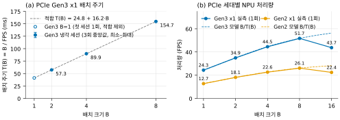
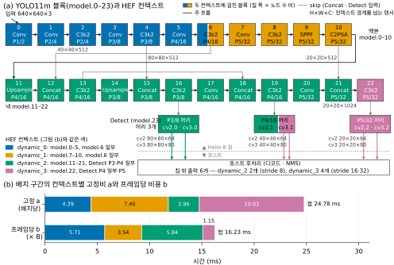
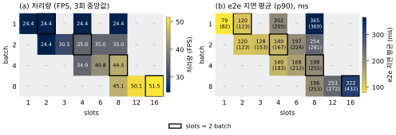
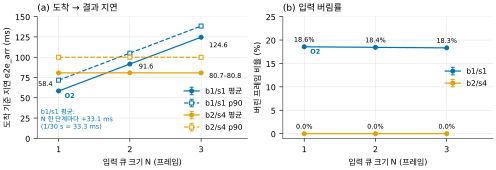
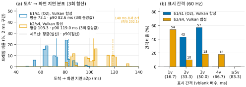
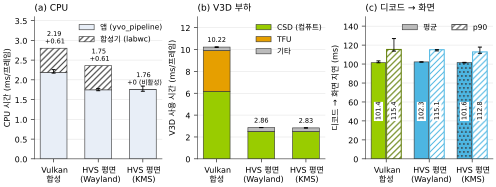
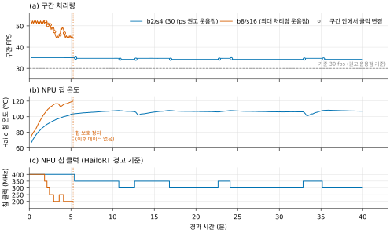

# 제로 카피 버퍼 공유와 GPU 오프로딩을 통한 임베디드 객체 검출 파이프라인의 호스트 부하 최소화
## — Raspberry Pi 5와 Hailo-8 NPU 기반 실시간 구현

**Minimizing Host Overhead in an Embedded Object Detection Pipeline
via Zero-Copy Buffer Sharing and GPU Offloading
— A Real-Time Implementation on Raspberry Pi 5 with Hailo-8 NPU**

저자: `[작성 필요]`

소속: `[작성 필요]`

교신저자: `[작성 필요]`

---

## 요약

엣지 환경의 객체 검출은 NPU(Neural Processing Unit)의 보급으로 추론 자체의 비용은 크게 낮아졌으나,
전처리·후처리·가시화가 여전히 호스트 CPU에 남아 전체 파이프라인의 병목으로 작용한다.
본 논문은 Raspberry Pi 5(BCM2712)와 Hailo-8 NPU로 구성된 단일 보드 환경에서,
하드웨어 비디오 디코더·GPU(VideoCore VII)·NPU·디스플레이를 **dma-buf 기반 제로 카피 버퍼 공유**로
연결하고, 전처리·후처리·가시화를 **GPU 컴퓨트 셰이더로 오프로딩**하여 호스트 부하를 최소화한
실시간 객체 검출 파이프라인을 제안한다.

제안 기법의 핵심은 세 가지다. 첫째, GPU 전처리가 NPU의 **장치 입력 레이아웃(NHCW)을 직접 생성**하여
런타임의 호스트 측 레이아웃 변환을 제거한다. 이 과정에서 변환 비용의 실체가 전치(transpose) 연산이 아니라
**CPU가 비캐시 GPU 메모리를 stride 접근으로 읽는 비용**임을 대역폭 측정으로 규명하였다
(순차 1.479 GB/s, stride-3 접근 시 0.088 GB/s).
둘째, NPU의 원시 출력 텐서를 GPU 버퍼로 직접 수신하여 호스트 NMS(Non-Maximum Suppression)를 GPU 디코드로 대체한다.
억제는 처음에 CPU에서 수행하였고(§6.5), 이후 CPU 기준 구현과 비트 단위로 일치하는 GPU 셰이더로 옮겼다
(일치를 보장할 수 없는 경계 프레임만 CPU가 처리한다). 표시 통합 수치(§6.7)는 후자의 구성에서 잰 값이다.
셋째, 디코더가 생성한 프레임을 추가 복사 없이 표시 경로가 재사용하여 가시화를 GPU 안에서 완결한다.

1920×1080 30 fps HEVC 입력과 YOLOv11m 모델에 대해, GPU 전처리까지 적용한 호스트 NMS 경로(표시 없음)와 비교하면
후처리와 가시화까지 GPU로 옮긴 제안 파이프라인은 표시를 켜고도 응용·컴포지터·커널 스레드를 합친 파이프라인 호스트 CPU를
프레임당 **3.189 ms에서 2.505 ms로 약 21% 줄였다**. 두 값은 같은 회차의 3회 중앙값이고 표시는 최대속도 페이싱이다.
같은 회차 실행끼리 짝지은 감소율은 17~29%이며, 응용과 컴포지터만 보면 약 32%, 응용 프로세스만 보면 3.089 → 1.622 ms(짝지은 감소율 45~53%)다.
디코드를 소스 30 fps 시각표에 맞춰 시작하는 별도 실행(버림 없는 소스 속도 페이싱, §6.6.3의 leaky 입력 큐와 다른 장치)에서는
파이프라인 CPU 2.567 ms/frame에 **응용 기준 표시 지연(빈 슬롯 획득 → 화면 도달, 촬영·디코드 제외) 중앙값 약 97 ms
(3회 범위 90.5~100.1 ms), 프레임 드롭 0**으로 실시간 표시를 달성한다. 다만 표시 간격은 고르지 않다(§6.7).
두 값은 **서로 다른 실행**이므로 섞어 인용해서는 안 된다(§6.7 표).
이 수치는 GPU 클럭 1150 MHz, 디코더 1스레드, GPU 억제 조건에서 측정한 값이다(§6.7).
§6.1 조건의 측정 이후 추가한 입력 페이싱(프레임이 소스 시각에 도착)에서는 배치 1/슬롯 1과 크기 1의 입력 큐가 도착 기준 평균 **58.4 ms**의
최저 지연을 내며, 처리하지 못하는 약 19%의 프레임을 버린다(GPU 1150 MHz, 디코더 1스레드, 표시 없음, §6.6.3).
검출 결과는 기준 경로와 **1,816프레임에서 9,457개로 완전히 동일**하여 정확도 손실이 없음을 확인하였다.
처리량은 PCIe 대역폭에 의해 제한되므로 개선되지 않았으며(최대속도 페이싱 34.97 → 34.89 fps), 본 연구의 기여는
처리량이 아니라 호스트 부하와 실시간 가시화 경로의 확보에 있다.

**주제어**: 임베디드 추론, 이기종 컴퓨팅, 제로 카피, dma-buf, GPU 컴퓨트 셰이더, NPU, 실시간 객체 검출, 엣지 AI

---

## Abstract

While NPUs have substantially reduced the cost of inference itself in edge object detection,
preprocessing, postprocessing, and visualization remain on the host CPU and become the pipeline bottleneck.
This paper presents a real-time object detection pipeline on a single board comprising a Raspberry Pi 5
(BCM2712) and a Hailo-8 NPU, in which the hardware video decoder, the GPU (VideoCore VII), the NPU, and
the display are connected through **dma-buf based zero-copy buffer sharing**, and preprocessing,
postprocessing, and visualization are **offloaded to GPU compute shaders**.

Three contributions are central. First, GPU preprocessing directly produces the **device input layout (NHCW)**
of the NPU, eliminating host-side layout conversion at runtime; we further identify that the dominant cost of
this conversion is not the transpose operation but the **CPU reading uncached GPU memory with strided access**
(1.479 GB/s sequential versus 0.088 GB/s at stride 3). Second, raw output tensors of the NPU are received
directly into GPU buffers, replacing host NMS with GPU decoding; suppression, first done on the CPU (Section 6.5),
was later moved to a GPU shader that matches the CPU reference bit for bit, with only boundary frames falling back
to the CPU. The display-integrated figures (Section 6.7) were measured with the latter.
Third, decoder-produced frames are reused by the display path without additional copies, keeping
visualization entirely within the GPU.

For 1920×1080 30 fps HEVC input with YOLOv11m, compared with a host-NMS path that already uses GPU preprocessing
(no display), the proposed pipeline, which also moves postprocessing and visualization to the GPU, reduces the pipeline's
host CPU time (the application, the compositor, and kernel threads) from **3.189 ms to 2.505 ms per frame (about −21%;
−17% to −29% when runs of the same session are paired)** with the display running at full speed (application and compositor
only: about −32%; the application process alone: 3.089 → 1.622 ms, −45% to −53% paired). In a separate run in which decoding
is started on the 30 fps source timetable (lossless source-rate pacing, distinct from the leaky input queue of Section 6.6.3),
the pipeline uses 2.567 ms of host CPU per frame and reaches **a median application-level display latency (free-slot
acquisition to screen, excluding capture and decode) of about 97 ms (90.5–100.1 ms over three runs) with zero dropped frames**, though the presentation
intervals are uneven (Section 6.7); the two runs
must not be combined. Both were measured with the GPU at 1150 MHz, one decoder thread, and GPU-side suppression
(Section 6.7). With input pacing, added after the original Section 6.1 measurements (frames arrive at their source times;
GPU at 1150 MHz, one decoder thread, no display), batch 1 with one slot and a one-frame input queue reaches the lowest
latency of **58.4 ms mean from frame arrival** while dropping the ~19% of frames it cannot process (Section 6.6.3).
Detection results are **identical to the reference path (9,457 detections over 1,816
frames)**, confirming no accuracy loss. Throughput is bounded by PCIe bandwidth and therefore does not
improve (34.97 → 34.89 fps); the contribution of this work lies in host overhead and in securing a
real-time visualization path, not in throughput.

**Keywords**: embedded inference, heterogeneous computing, zero-copy, dma-buf, GPU compute shader, NPU,
real-time object detection, edge AI

---

# 1. 서론

## 1.1 연구 배경

엣지 디바이스에서 딥러닝 기반 객체 검출을 실시간으로 수행하려는 요구가 늘면서, 전용 NPU를 탑재한
저가형 단일 보드 컴퓨터가 널리 보급되고 있다. Hailo-8과 같은 엣지 NPU는 수 TOPS급 연산을 수 와트의
전력으로 제공하여, 과거 GPU 서버가 담당하던 추론을 보드 수준으로 내려놓았다.

그러나 **추론이 빨라질수록 추론 이외의 구간이 병목으로 드러난다.** 실제 파이프라인은 추론만으로
구성되지 않는다. 비디오를 디코드하고, 모델 입력 규격에 맞게 크기·색공간·레이아웃을 변환하고,
모델 출력을 디코드하여 NMS를 수행하고, 결과를 화면에 표시해야 한다. 이들 구간이 호스트 CPU에 남아
있으면 NPU가 아무리 빨라도 전체 처리량과 지연은 CPU에 의해 결정된다.

본 연구의 대상 플랫폼에서 이 문제는 다음과 같이 나타났다. 최적화 이전 구성에서 프레임당 호스트 CPU
시간은 **17.6 ms**였고, 그중 **약 14 ms가 순수하게 레이아웃 변환**에 소모되었다. 이는 NPU 한 프레임
처리 주기(약 19~29 ms)에 필적하는 값으로, 4코어 중 거의 1개를 상시 점유하는 부담이다.
가시화를 추가하려 하면 문제는 더 심해진다. 1920×1080 RGBA 프레임을 CPU로 생성하면 프레임당
10 ms 이상이 추가로 필요하며, 이는 어렵게 확보한 CPU 여유를 그대로 반납하는 결과가 된다.

## 1.2 문제 정의

본 논문이 다루는 문제는 **"추론을 제외한 모든 구간에서 호스트 CPU의 개입을 제거할 수 있는가"** 이다.
구체적으로 세 가지 하위 문제로 나뉜다.

**(P1) 버퍼 이동 비용.** 디코더 출력, 전처리 결과, 추론 출력, 표시 프레임이 서로 다른 프로세서에
속한다. 이들 사이를 메모리 복사로 연결하면 프레임당 수 MB의 복사가 발생한다.

**(P2) 형식 변환 비용.** 모델의 장치 입력 형식과 일반적인 영상 표현 형식이 다르다. 이 차이를 런타임
라이브러리가 호스트에서 흡수하면 변환 비용이 CPU에 전가된다.

**(P3) 후처리·가시화의 잔여 CPU.** 추론 출력의 디코드와 NMS, 그리고 화면 출력이 CPU에 남는다.

## 1.3 기여

본 논문의 기여는 다음과 같다.

1. **HW 디코더·GPU·NPU·디스플레이를 잇는 dma-buf 기반 제로 카피 체인을 설계하고 구현하였다.**
   파이프라인 전 구간에서 CPU 메모리 복사가 발생하지 않으며, 입력과 출력 모두를 dma-buf로 사용하는
   NPU 추론 경로가 실제로 동작함을 실증하였다(§4.2, §6.5).

2. **GPU 전처리가 NPU의 장치 입력 레이아웃을 직접 생성하도록 하여 런타임 호스트 변환을 제거하였다.**
   이로써 프레임당 CPU 시간이 17.6 ms에서 3.5 ms로 감소하였다. 나아가 이 비용의 실체가 전치 연산이
   아니라 **CPU의 비캐시 GPU 메모리 읽기**임을 대역폭 측정으로 규명하였다(§6.3, §6.4).
   이 관찰은 특정 모델이나 프레임워크에 국한되지 않는 설계 원칙을 제공한다.

3. **전처리·후처리·가시화를 모두 GPU 컴퓨트 셰이더로 오프로딩하였다**(억제의 경계 프레임 제외).
   표시를 포함한 상태에서도 응용·컴포지터·커널 스레드를 합친 파이프라인 호스트 CPU가 프레임당 3.189 ms에서 2.505 ms로 약 21%(같은 회차 실행끼리
   짝지으면 17~29%) 감소하였다. 응용 프로세스만은 3.089 → 1.622 ms다. 기준은 GPU 전처리를 적용한 호스트 NMS 경로(표시 없음)이고, 조건은 §6.7(GPU 1150 MHz·디코더 1스레드·GPU 억제)이다.
   측정 빌드에서는 두 경로 모두 추론 완료 이벤트로 슬롯 대기를 끝낸다(§4.6.3).

4. **정확도 손실이 없음을 대규모 비교로 검증하였다.** 1,816프레임에 대해 검출 총수가
   기준 경로와 완전히 동일하며(9,457개), IoU 0.9 기준 매칭 비율이 0.9990이다(§6.8).

5. **최저 지연 운용점을 프레임 도착 시점 기준으로 정의하고 측정하였다(측정 이후 추가).** 파일 입력의 지연 하한 중 절반 이상이
   디코드가 앞서 달려 생긴 슬롯 대기임을 보이고, 입력 페이싱과 크기 1의 leaky 입력 큐로 이를 제거하여 도착 기준 평균 58.4 ms를 얻었다.
   입력 큐를 키우면 지연만 늘고 30 fps 추종 설정에서는 효과가 없음도 확인하였다(§6.6.3).

본 논문은 아울러 **처리량이 개선되지 않았음을 명시한다.** 대상 플랫폼의 처리량 상한은 PCIe Gen3 x1
대역폭이 결정하며, 제안 기법은 이 상한을 바꾸지 못한다. 기여는 호스트 부하 절감과, 그로 인해
비로소 가능해진 실시간 가시화 경로의 확보에 있다.

---

# 2. 관련 연구

## 2.1 엣지 NPU 추론 파이프라인

엣지 가속기를 활용한 객체 검출 연구는 주로 모델 경량화와 양자화에 집중되어 왔다. 그러나 실제 배포
환경에서는 모델 외적 요소, 즉 입출력 처리와 메모리 이동이 성능을 좌우하는 경우가 많다.
스마트폰 SoC에서는 추론 바깥의 전·후처리와 데이터 이동이 종단간 성능을 좌우함이 보고되었고 [R7],
서버 환경의 컴퓨터 비전 추론에서도 전처리와 데이터 이동이 지연의 큰 몫을 차지한다 [R8].
본 연구와 같은 Raspberry Pi 5 + Hailo 계열 구성으로 실시간 YOLO 추론을 탑재한 사례 [R9]와,
저비용 엣지 AI 가속기들의 추론 성능과 비용 효율을 비교한 국내 연구 [R10]도 있다.
본 연구는 모델을 고정한 상태에서 파이프라인 구조만으로 호스트 부하를 줄이는 방향을 취한다.

## 2.2 dma-buf 기반 제로 카피

Linux 커널의 dma-buf 프레임워크는 서로 다른 디바이스 드라이버가 동일한 물리 버퍼를 파일 디스크립터로
공유하도록 한다 [R3]. 멀티미디어 파이프라인에서 디코더와 디스플레이 사이의 제로 카피는 널리 쓰이는
기법이고¹, 모바일 GPU 추론에서도 텍스처를 입출력으로 직접 써서 복사를 없애는 엔진이 있다 [R13].
그러나 저자가 확인한 범위에서는 본 연구처럼 **디코더·GPU·NPU·디스플레이 네 주체가 하나의 체인**을 이루는 사례를 찾지 못했다.
특히 추론 가속기의 입력과 출력을 **동시에** dma-buf로 운용하는 구성은 벤더 문서에서도 명시된 사례를
확인하지 못해, 본 연구에서 별도의 검증 과정을 거쳤다(§6.5).

¹ M. Tretter and P. Zabel, "Zero-Copy Video Streaming on Embedded Systems the Easy Way," Embedded Linux Conference Europe, 2017-10-25, 발표자료.
https://static.sched.com/hosted_files/osseu17/e2/zero-copy_video_streaming.pdf (접근일: 2026-10-13)

## 2.3 GPU 컴퓨트 오프로딩

모바일·임베디드 GPU를 범용 연산에 쓰는 연구는 Vulkan 컴퓨트 벤치마크 [R12], 모바일 GPU 신경망 추론 엔진 [R11],
셰이더 기반 경량 추론 엔진 [R13] 등으로 이어져 왔다. 본 연구의 셰이더는 Vulkan 1.3 core 기능만 사용한다 [R2].
본 연구의 차별점은 오프로딩 대상을 전처리에 한정하지 않고 **후처리와 가시화까지 확장**하였다는 점,
그리고 오프로딩의 이득을 결정하는 것이 연산량이 아니라 **메모리 접근 특성**임을 실측으로 보인 점이다.

> **참고문헌 정책**: 본 절의 인용 `[R*]`은 §참고문헌에 대응한다. 서지사항은 2026-10-13에 DOI·Crossref·발행처 페이지로
> 확인하였고, 확인하지 못한 필드는 `[확인 필요]`로 표시하였다. 비학술 자료는 각주로 단다.

---

# 3. 배경: 대상 플랫폼과 지배적 제약

## 3.1 하드웨어 구성

**표 1.** 하드웨어 구성

| 구성요소 | 사양 |
|---|---|
| SoC | Broadcom BCM2712 (Cortex-A76 ×4 @ 2.4 GHz) [R5] |
| GPU | VideoCore VII (V3D 7.1), Mesa V3DV 26.2.2 [R6], Vulkan 1.3 |
| GPU 클럭 | **960 MHz** (부트로더 2025-12-08의 펌웨어 기본값, §6.1에서 원 조건으로 분류한 측정). 부트로더 2026-09-25부터 1150 MHz이며, §6.1의 "측정 이후 바뀐 조건"에 적은 절은 이 값에서 쟀다 |
| NPU | Hailo-8, PCIe Gen3 ×1 (8.0 GT/s), HailoRT 4.24.0 [R4] |
| 비디오 디코더 | BCM2712 내장 HEVC 하드웨어 디코더 |
| 디스플레이 | HDMI-A-1, 1920×1080@60 (Wayland 컴포지터) |
| 커널 | Linux 6.18.50 |

PCIe 링크 속도는 문서값이 아니라 sysfs의 `current_link_speed`로 매 측정 시 확인하였다.
이는 링크 세대가 NPU 처리량을 거의 배로 바꾸는 지배적 변수이기 때문이다(§6.6).

## 3.2 모델과 텐서 사양

모델은 YOLOv11m [R1]을 Hailo 컴파일러로 변환한 것을 사용하였다.

**표 2.** 모델(HEF) 사양

| 항목 | 값 |
|---|---|
| 네트워크 그룹 | Multi Context, **컨텍스트 4개** |
| VStream 입력 | UINT8, **NHWC** 640×640×3 |
| **장치 스트림 입력** | UINT8, **NHCW** 640×640×3, `hw_frame_size` = 1,228,800 B |
| VStream 출력 | FLOAT32, `yolov8_nms_postprocess` (80클래스, 클래스당 최대 100박스, 160,320 B) |
| **장치 스트림 출력** | UINT8 **NHCW 6개**, 합계 **1,221,120 B** |

장치 출력 6개 텐서의 상세는 다음과 같다.

**표 3.** 장치 출력 텐서 6개의 사양

| 스트림 | 역할 | shape (hw_shape) | 바이트 | zero-point | scale |
|---|---|---|---:|---:|---|
| `conv74_178` | cls (P3) | 80×80×80 | 512,000 | 0 | 0.0034697596 |
| `conv71_178` | box (P3) | 80×80×64 | 409,600 | 88 | 0.1145507 |
| `conv90_178` | cls (P4) | 40×40×80 | 128,000 | 0 | 0.0037657837 |
| `conv87_178` | box (P4) | 40×40×64 | 102,400 | 74 | 0.079821944 |
| `conv105_178` | cls (P5) | 20×20×80 (20×**24**×80) | 38,400 | 0 | 0.0038187786 |
| `conv102_178` | box (P5) | 20×20×64 (20×**24**×64) | 30,720 | 81 | 0.074821874 |

두 가지가 설계에 직접 영향을 준다.

**(1) 이 모델의 NMS는 온칩이 아니다.** `yolov8_nms_postprocess`는 장치가 아니라 **호스트 CPU**에서
실행되는 VStream 연산이다. 즉 장치는 원시 텐서 1,221,120 B를 매 프레임 PCIe로 내보내고 있으며,
호스트가 그것을 160,320 B로 줄이는 구조다. 따라서 **원시 출력으로 전환해도 PCIe 트래픽은 늘지 않는다.**

**(2) VStream 입력은 NHWC지만 장치 입력은 NHCW다.** 응용이 NHWC로 데이터를 넘기면 런타임이
호스트에서 레이아웃을 변환한다. 이 차이가 §1.1에서 언급한 14 ms의 출처다.

**(3) P5 텐서는 폭이 24로 패딩되어 있다.** 유효 폭은 20이며, 소비 측은 `w < 20`으로 순회해야 한다.

## 3.3 설계를 지배하는 세 가지 제약

### 제약 1 — GPU 메모리가 비캐시다

대상 GPU가 노출하는 Vulkan 메모리 타입은 `DEVICE_LOCAL | HOST_VISIBLE | HOST_COHERENT` **한 종류뿐**이며,
`HOST_CACHED`가 존재하지 않는다. 즉 **GPU가 쓴 버퍼를 CPU가 캐시된 상태로 읽는 선택지가
드라이버 수준에 없다.** 이 제약이 파이프라인 설계 전반을 지배한다(§6.3에서 정량화).

주목할 점은 이 제약이 **방향 비대칭**이라는 것이다. 쓰기는 write-combine 버퍼링으로 빠르지만,
읽기는 매번 메모리까지 도달한다. 따라서 "CPU → GPU 쓰기"는 값싸고 "GPU → CPU 읽기"는 비싸다.

### 제약 2 — 처리량 상한은 PCIe가 정한다

NPU의 배치 크기 B에 대한 한 배치 처리 시간을 측정하여 선형 모델을 구하면 다음과 같다(냉각 상태).

> **T(B) = 24.8 + 16.2 · B  [ms]**

배치당 고정비 24.8 ms와 프레임당 16.2 ms로 분해된다. PCIe를 Gen2에서 Gen3로 변경했을 때
**두 항이 모두 정확히 절반으로 감소**한 점은 두 항이 모두 전송 지배적임을 시사한다.
이 모델의 점근 처리량 상한은 1/0.0162 ≈ **61.6 fps**이며 실측 상한은 51.7 fps다.
**제안 기법은 이 상한을 바꾸지 못한다.**



**그림 1.** NPU 배치 주기와 PCIe 세대별 처리량. (a) T(B)는 `hailortcli benchmark`의 처리량에서 역산한 값(T = B / fps)이고, 점선은 B = 2·4·8의
3회 중앙값에 맞춘 선형 적합 T(B) = 24.8 + 16.2·B ms다. 빈 원(B = 1)은 다른 세션의 1회 측정으로 적합에서 뺐다. (b) Gen2 x1과 Gen3 x1의 처리량과
세대별 모델 B / T(B). Gen3가 1.92~1.98배다. B = 16에서는 처리량이 떨어진다(측정: 2026-09-20, HailoRT 4.24.0 `hailortcli benchmark` 랜덤 입력,
(a) Gen3 x1 냉각 세션 반복 3, (b) Gen2·Gen3 x1 반복 1(Gen3 B = 16은 냉각 뒤 재측정), 원본: `07_results/op_point/runs/latency_gen3_cooled/`,
`07_results/npu_benchmark/runs/{gen2,gen3,gen3_cooled}/`).


> 측정 이후(2026-10-12) NPU 펌웨어의 액션 타임스탬프로 이 모델을 컨텍스트별로 나눴다(B = 1·2·8 × 3회). 배치 구간은
> 24.79 + 16.23·B ms로 모델을 재현하고, 고정비는 컨텍스트 4개에 10.0(마지막 컨텍스트)·7.4·4.4·3.0 ms로 나뉜다. 고정비는 각 컨텍스트가
> 배치마다 다시 받는 설정 데이터(합 20.5 MB, 실효 0.83 GB/s)에, 프레임당 몫은 컨텍스트 사이 텐서의 호스트 왕복(12.8 MB, 0.79 GB/s)에
> 컨텍스트 단위로 대응하며 컨텍스트 전환 자체의 비용은 0.01 ms다. 즉 두 항 모두 PCIe 전송 바이트로 설명된다. 줄일 수 있는 것은 전환이 아니라
> 바이트이고, 그 상한(컨텍스트가 적은 HEF)은 모델 교체를 요구한다. 액션 이름의 해석은 공식 문서가 없어 추정이다.



**그림 2.** (a) YOLO11m(ultralytics yolo11.yaml, scale m) 블록 model.0–23과 HEF 컨텍스트 4개의 대응.
dynamic_0은 model.0–5와 6 일부, dynamic_1은 6 나머지와 7–10(SPPF·C2PSA), dynamic_2는 넥 model.11–21과 Detect P3 머리·P4 머리 일부,
dynamic_3은 model.22와 P4 머리 나머지·P5 머리를 계산한다. 두 색으로 나눈 상자는 두 컨텍스트에 걸친 블록이고 칠 폭은 컨텍스트별 ONNX 노드 수 비다.
칩 밖 출력 6개(dynamic_2의 stride 8 두 개, dynamic_3의 stride 16·32 네 개)는 호스트 쪽 후처리로 간다.
(b) 배치 구간의 컨텍스트별 고정비 a와 프레임당 비용 b(구간 = a + b·B). 고정비 24.8 ms 중 dynamic_3가 10.0 ms(40%)로 가장 크다.
적합 잔차 rms는 dynamic_1이 0.263 ms(B = 2 3회 중 1회가 0.93 ms 길었다)이고 나머지 셋은 0.01 ms 이하다
(분석 (a): 2026-10-14, HEF 컴파일러 메타데이터(hef.proto 스키마 밖 필드, 배치는 위치로 추정)로 판정하고 스키마의 경계 레이어와
펌웨어 액션 기록으로 4개 컨텍스트 모두 교차 확인, 장치 미사용, 원본: `07_results/hef_context_profile/evidence/context_layers.json`;
측정 (b): 2026-10-12, PCIe Gen3 x1, `hailortcli run2 measure-fw-actions` 펌웨어 타임스탬프, B = 1·2·8 × 반복 3(9회 적합),
원본: `07_results/hef_context_profile/evidence/breakdown.json`).


### 제약 3 — 컴퓨트 자원의 세부 한계

V3D의 Vulkan 한계 중 설계에 영향을 준 항목은 다음과 같다.

- 스테이지당 스토리지 버퍼 8개, 스토리지 이미지 4개, `descriptorIndexing` 미지원
- `shaderStorageImageWriteWithoutFormat = false` → 컴퓨트에서 스왑체인에 직접 쓰려면 `rgba8` 고정
- 서브그룹 크기 16 고정, 워크그룹 최대 256 invocation
- `shaderInt64 = false`, Vulkan Video 확장 없음 → GPU는 영상 디코드를 맡을 수 없고, 셰이더는 32비트 정수만으로 작성해야 한다
  (범용 프레임워크의 Vulkan 컴퓨트 코덱도 이 기능들을 전제로 하여 이 GPU에서 동작하지 않음을 확인하였다, §6.2)
- 타일 기반 렌더러이므로, 컴퓨트가 쓴 이미지에 렌더패스를 열면 프레임버퍼 전체 로드/스토어가 발생

마지막 항목 때문에 오버레이를 그래픽스 파이프라인이 아닌 **컴퓨트 래스터라이저**로 구현하였다(§4.5).

---

# 4. 제안 파이프라인

## 4.1 전체 구조

```
  HEVC 비트스트림
        │
        ▼  ① libavcodec DRM_PRIME              [HW 디코더]
  DrmFrame : Y dma-buf + UV dma-buf (SAND128 NV12, 1920×1088)
        │
        ├──────────────────────────────────────────────┐
        ▼  ② sand_letterbox.comp        [GPU]          │ (표시용으로 동일 버퍼 유지)
  NHCW 640×640×3  ── export dma-buf                    │
        │                                              │
        ▼  ③ infer_async (H2D dma-buf)  [NPU]          │
  원시 6텐서 (D2H dma-buf, GPU 버퍼에 직접 수신)       │
        │                                              │
        ▼  ④ yolo_decode.comp           [GPU]          │
  후보 검출 (원본 좌표계)                              │
        ▼  ⑤ 억제(NMS)                  [GPU]          │
  최종 검출                                            │
        │                                              │
        ▼──────────────────────────────────────────────┘
        ▼  ⑥ display_convert.comp + overlay_boxes.comp  [GPU]
  스왑체인 이미지 (RGBA8)
        ▼  ⑦ present (FIFO)
  HDMI
```

> 위 그림은 현재 구성이다. ⑤ 억제는 같은 커맨드 버퍼 안의 GPU 셰이더(`efficient_nms.comp`, CPU 기준과 비트 일치, 경계 프레임만
> CPU 처리)이며, 초기 구성에서는 CPU(greedy NMS)였다. ⑥⑦에는 디코더 프레임을 디스플레이 컨트롤러(HVS) 평면에 직접 올리는
> 대안 경로가 있다. **§6.1의 "측정 이후 바뀐 조건"에 적은 절(§6.6.3, §6.7, §6.7.1, §6.8.5, §7.4 (1))과 초록·결론의 헤드라인은
> 이 구성에서 잰 값이고, 나머지 §6 수치는 ⑤가 CPU인 초기 구성에서 잰 값이다.** 두 변경의 정식 측정 결과는 §6.1(억제 위치)과 §6.7.1(평면 표시)에
> 바뀐 조건과 함께 적었다.

①~⑦ 전 구간에서 **CPU 메모리 복사가 발생하지 않는다.** CPU가 접근하는 데이터는 최종 검출(초기 구성에서는 ⑤의 입력인 후보 검출,
프레임당 약 16개, 약 0.5 KB)과 오버레이에 올릴 검출 정보(약 2.7 KB)뿐이며, 후자는 §3.3의
방향 비대칭에 따라 **CPU → GPU 쓰기**이므로 값싸다.

## 4.2 제로 카피 버퍼 공유

파이프라인에는 서로 다른 수명과 소유자를 갖는 **세 개의 dma-buf 그룹**이 존재한다.

**표 4.** 파이프라인의 dma-buf 그룹과 수명

| 그룹 | 할당 주체 | 생산자 → 소비자 | 개수 |
|---|---|---|---|
| A. 디코더 프레임 (SAND128 NV12) | 디코더 프레임 풀 | 디코더 → GPU 전처리 **및** GPU 표시 변환 | 프레임당 2 (Y, UV) |
| B. 전처리 출력 (NHCW) | Vulkan export | GPU → NPU (H2D) | 슬롯당 1 |
| C. 원시 출력 텐서 | Vulkan export | NPU (D2H) → GPU 후처리 | 슬롯당 6 |

> HVS 평면 표시 경로에서는 그룹 A의 표시 쪽 소비자가 GPU 표시 변환이 아니라 디스플레이 컨트롤러 자체가 되고,
> GPU가 그린 박스 오버레이 버퍼(AB24, Vulkan export → 디스플레이 컨트롤러)가 네 번째 그룹으로 추가된다.

그룹 A는 **하나의 버퍼가 두 소비자에게 동시에 전달된다.** 전처리와 표시 변환이 모두 같은 디코더
프레임을 읽으며, 둘 다 읽기 전용이므로 내용 경쟁이 없다. 각 소비자는 자신의 import 캐시를 통해
파일 디스크립터를 `VkBuffer`로 매핑한다.

그룹 B와 C는 **Vulkan이 할당하고 export**한다. 즉 GPU가 소유한 메모리를 NPU가 DMA 대상으로 삼는
구조다. 이 방향(GPU 할당 → NPU DMA)을 택한 이유는 §4.3의 레이아웃 정합 때문이다. GPU가 출력
레이아웃을 직접 결정하려면 출력 버퍼가 GPU의 것이어야 한다.

외부 디바이스가 소유한 메모리와 GPU 사이의 접근 순서는 큐 패밀리 소유권 이전 배리어로 보장한다.
커맨드 버퍼 앞에 `FOREIGN_EXT → 컴퓨트` acquire, 뒤에 release를 배치한다.

## 4.3 NPU 입력 레이아웃 정합

### 4.3.1 착안

§3.2에서 보았듯 모델의 VStream 입력은 NHWC이나 장치 입력은 NHCW다. 응용이 NHWC로 데이터를 제공하면
런타임이 호스트에서 전치를 수행한다. **본 연구는 GPU 전처리 셰이더가 처음부터 NHCW로 출력하도록 하여
이 단계를 제거한다.**

NHWC와 NHCW의 인덱싱은 다음과 같다.

- NHWC: `idx = (h · W + w) · C + c`
- NHCW: `idx = (h · C + c) · W + w`

전처리 셰이더는 어차피 픽셀 값을 계산하여 어딘가에 써야 하므로, **쓰기 주소와 패킹 방식만 달라질 뿐
계산량은 동일하다.** 실제로 두 레이아웃의 GPU 셰이더 시간은 중앙값 2.123 ms와 2.124 ms로 차이가 없다.
이는 대상 GPU가 쓰기 패턴에 둔감하기 때문이며, 셰이더 시간의 대부분이 샘플 주소 계산과 로드에
소모되기 때문이다.

구현상으로는 출력 레이아웃을 **특수화 상수(specialization constant)** 로 두어 하나의 셰이더가
두 레이아웃을 모두 생성하도록 하였다. 픽셀 값 계산 경로는 공유되며 쓰기 경로만 분기한다.

NHCW에서는 채널마다 4픽셀이 하나의 32비트 워드에 정렬되어 떨어지므로(`c0 | c1<<8 | c2<<16 | c3<<24`)
오히려 패킹이 단순해진다. 반면 NHWC는 픽셀 경계를 가로지르는 패킹이 필요하다.

### 4.3.2 비용의 실체

이 최적화의 효과는 프레임당 CPU 시간 **17.6 ms → 3.5 ms**로 나타났다. 그런데 이 14 ms라는 값은
전치 연산의 계산량으로 설명되지 않는다. 동일한 전치를 일반 malloc 버퍼에서 수행하면 약 1.2 ms에
불과하다. **10배 이상의 차이가 어디서 오는지가 본 절의 핵심 관찰이다.**

원인은 §3.3 제약 1이다. 전처리 출력은 GPU가 할당한 `HOST_COHERENT` 메모리이며, 런타임의 전치
루프는 이 메모리를 **1바이트씩 stride 3으로 읽는다.** 캐시가 없는 매핑에서 stride 접근은 캐시 라인을
전혀 활용하지 못하므로 최악의 패턴이 된다. §6.3에서 이를 대역폭으로 정량화한다.

따라서 이 최적화의 본질은 **"전치를 없앤 것"이 아니라 "GPU가 쓴 메모리를 CPU가 읽는 일을 없앤 것"**
이다. 이 해석은 다음의 일반화된 설계 원칙으로 이어진다.

> **원칙**: 통합 GPU가 비캐시 메모리만 노출하는 플랫폼에서, GPU가 생산한 버퍼를 CPU가 순회하는
> 모든 설계는 연산량으로 예측한 것보다 약 10배 비싸다. 해당 버퍼는 GPU 또는 DMA가 소비해야 한다.

## 4.4 GPU 후처리와 억제

### 4.4.1 원시 출력 경로

호스트 NMS를 제거하려면 원시 텐서 6개를 직접 수신해야 한다. 대상 런타임의 고수준 추론 API는
이 용도로 사용할 수 없음을 확인하였다(장치 입력 레이아웃을 지정하면 구성 단계에서 거부된다).
따라서 저수준 경로, 즉 네트워크 그룹을 직접 구성하고 비동기 추론 요청을 발행하는 방식을 사용한다.

이때 **입력과 출력을 모두 dma-buf로 지정**한다. 추론 요청의 버퍼 서술자는 입출력을 구분하지 않는
단일 맵이므로 구조적으로 가능하지만, 실제 동작 여부는 문서화되어 있지 않아 별도로 검증하였다(§6.5).

### 4.4.2 GPU 디코드 셰이더

`yolo_decode.comp`는 스케일 3개(P3/P4/P5)에 대해 각각 한 번씩, 총 3회 디스패치된다.
각 디스패치는 다음을 수행한다.

1. 클래스 텐서를 **정수 도메인에서 사전 필터링**한다. 점수 임계값 `thr`에 대응하는 정수 경계
   `q_thr_low = floor(thr / qp_scale)`를 미리 계산해 두면, 역양자화 없이 바이트 비교만으로
   대부분의 앵커를 배제할 수 있다. 본 모델에서 이 값은 P3/P4/P5에 대해 각각 57/53/52이다.
2. 통과한 앵커에 대해서만 역양자화, DFL(Distribution Focal Loss) 소프트맥스, 박스 디코드를 수행한다.
3. letterbox 역변환을 적용하여 **원본 프레임 좌표계**로 후보를 기록한다.

이 구조의 이점은 **박스 텐서의 대부분을 읽지 않는다**는 데 있다. 클래스 텐서 678,400 B는 전부 읽지만
박스 텐서 542,720 B 중 실제로 읽는 양은 약 15 KB에 불과하다.

NHCW 레이아웃은 CPU에게는 최악이었으나 **GPU에게는 유리하다.** `idx = (h·C + c)·W + w`이므로
(h, c)를 고정하면 w가 연속이며, invocation을 w축에 매핑하면 메모리 접근이 완전히 병합(coalesce)된다.
동일한 레이아웃이 소비자에 따라 정반대의 성질을 갖는다는 점은 §7에서 다시 논의한다.

### 4.4.3 억제(NMS)

억제는 같은 커맨드 버퍼 안의 GPU 셰이더(`efficient_nms.comp`)에서 수행하고, CPU 기준 구현과 비트 단위 일치를 보장할 수 없는
경계 프레임만 CPU 기준 구현으로 처리한다. 초기 구현은 억제를 CPU에서 수행하였으며(§6.1에서 원 조건으로 분류한 측정의 구성),
그 근거는 다음과 같다. 이관의 동기와 검증은 이 절 끝의 각주에 적었다.

- 프레임당 후보 수가 평균 16.81개(최대 45개)로 매우 적다. 이는 약 0.5 KB에 해당한다.
- 이 데이터를 CPU가 읽는 것은 §4.3.2의 stride 순회와 전혀 다른 성격이다. 작고 연속적이다.
- 실측 억제 비용은 프레임당 **2.2~2.7 µs**로, 전체 예산에서 무시할 수 있다.
- 억제는 본질적으로 순차 의존성이 있는 연산이며 GPU가 잘하는 작업이 아니다.
- CPU 기준 구현을 그대로 프로덕션 코드로 사용하므로 **기준 구현과 실사용 구현이 갈라지지 않는다.**

즉 이득의 대부분(호스트 NMS 비용)은 GPU 디코드 단계에서 발생하며, 억제를 GPU로 옮기는 추가 이득은
미미하다.

> 위 서술은 §6.1에서 원 조건으로 분류한 측정의 구성이다. 이후 억제는 같은 커맨드 버퍼 안의 GPU 셰이더(`efficient_nms.comp`)로
> 옮겨졌다. 동기는 성능보다 CPU 읽기 지점을 하나 더 없애고 GPU→CPU 경계를 최종 검출(수백 바이트)로 줄이는 데 있었다.
> 이 셰이더는 CPU 기준 구현과 **비트 단위로 일치**하도록 설계되어, 일치를 보장할 수 없는 경계 프레임만 CPU 기준 구현으로
> 처리한다. 따라서 "기준 구현과 실사용 구현이 갈라지지 않는다"는 성질은 비트 일치 검증으로 유지된다. 이후 정식 측정에서
> 1,816프레임 검출이 CPU 억제와 바이트 단위로 같았고(9,457개, 불일치 0, CPU 대체 경로 진입 0), 처리량·CPU 회귀가 없었다(§6.1).
> 후보가 약 11배인 혼잡 장면(MOT20)에서도 검출이 바이트 단위로 같고 처리량 변화가 없었다(§6.8.5).

## 4.5 GPU 가시화

가시화는 두 개의 컴퓨트 셰이더로 구성된다.

**`display_convert.comp`** — 디코더의 SAND128 NV12 dma-buf를 직접 읽어 스왑체인 이미지에
RGBA8로 쓴다. 중간 버퍼나 blit이 없다. 대상 GPU의 서피스가 `STORAGE` 사용을 지원하므로
컴퓨트 셰이더가 스왑체인 이미지에 직접 쓸 수 있다.

**`overlay_boxes.comp`** — 검출 박스·라벨·HUD를 같은 이미지에 이어서 그린다.
**검출 하나당 워크그룹 하나**를 배정하고 `vkCmdDispatchIndirect`로 디스패치 수를 GPU 버퍼에서 읽는다.
따라서 검출 수가 변해도 호스트가 개입하지 않는다.

두 셰이더는 **동일한 커맨드 버퍼에 연속 기록**되므로 present당 큐 제출은 1회다.
같은 이미지의 같은 픽셀에 쓰므로(WAW) 둘 사이에 이미지 메모리 배리어를 배치한다.

**표시 해상도는 원본 1920×1080 1:1을 사용한다.** 직관과 달리 해상도를 낮추는 것은 비용 절감 수단이
아니다. 1:1 경로는 최근접 사상이지만 축소 경로는 4-tap 쌍선형 보간을 수행하므로, 픽셀당 비용이
1.78 ns에서 4.51 ns(1600×900)로 증가하여 전체 시간이 오히려 늘어난다(§6.7).

## 4.6 슬롯 수명 관리와 스레딩

### 4.6.1 단일 큐 규율

대상 GPU는 컴퓨트 큐를 하나만 제공하며, Vulkan 큐는 외부 동기화 객체다. 전처리·후처리·표시 세
단계가 모두 큐 제출을 수행하므로, **세 제출을 모두 메인 스레드에서만 호출**하도록 규율을 정하였다.
그 결과 응용 코드가 다루는 스레드는 **메인 스레드 1개와 추론 런타임의 완료 콜백 스레드**뿐이며,
응용이 별도의 워커 스레드를 생성하지 않는다.†

† 라이브러리 내부 스레드는 별개다. §6의 측정 당시 디코더 라이브러리(libavcodec)는 프레임 스레드 5개를
자동으로 띄웠고(이후 기본값을 1개로 바꾸었다, §6.2), 추론 런타임도 내부 워커 스레드에서 호스트 NMS를 수행한다.

추론 완료 콜백은 "슬롯 s의 텐서가 준비되었다"는 사실만 큐에 넣고 즉시 반환한다.
콜백 안에서 Vulkan API를 호출하거나 GPU 메모리를 대량으로 읽는 것은 금지된다.

### 4.6.2 슬롯 상태 기계

프레임은 슬롯 단위로 관리되며, 슬롯은 전처리·추론·후처리·표시가 공유하는 번호 공간이다.
슬롯은 **두 조건이 모두 만족될 때만** 반납된다.

```
free ──acquire──▶ 전처리 ──펜스──▶ 추론 ──콜백──▶ 후처리 ──▶ compute_done ─┐
                                                                            ├──▶ free
                                       표시 제출 펜스 ──▶ display_done ─────┘
```

표시를 사용하지 않으면 `display_done`이 즉시 설정되어 기존 동작과 동일해진다.

표시가 활성화되면 디코더 프레임의 수명이 연장된다. 표시 변환이 디코더 버퍼를 직접 읽으므로,
해당 프레임은 추론이 끝나고 표시가 제출될 때까지 살아 있어야 한다. 이는 프레임 수명을
참조 계수로 관리하여 해결하였으며, 전처리 모듈의 기존 해제 로직은 수정하지 않았다.

### 4.6.3 교착 회피

2조건 반납 구조에서 `display_done`을 설정하는 주체가 메인 스레드 자신이므로, 메인 스레드가 빈 슬롯을
블로킹 대기하면 교착한다. 따라서 슬롯 획득을 **짧은 타임슬라이스 폴링**으로 바꾸고, 대기 루프 안에서
각 단계의 진행 함수를 호출한다.

```
while (빈 슬롯 없음) {
    추론단계_진행();      // 완료 큐 → 후처리 → compute_done
    전처리_완료분_전달();
    표시_진행();          // 표시 펜스 확인 → display_done
    슬롯 = 획득_시도(2 ms);
    if (전체 제한시간 초과) 예외;
}
```

> §6.6.3과 §6.7의 측정 빌드(커밋 `2f2d3d0`)에서는 이 대기가 추론 완료 이벤트로 일찍 끝나도록 바뀌었다. NPU 완료 콜백이 메인 스레드를
> 깨우고, GPU 후처리가 진행 중이면 폴링 대신 그 프레임을 바로 마무리한다. 표시를 켠 경우 표시 진행을 위해 500 µs 상한은 유지한다.
> 호스트 NMS 경로는 원래 추론 완료 시점에 대기가 끝났으므로, 이 변경으로 두 경로의 대기 방식이 같아졌다.
> 변경 이전 코드의 GPU 경로는 폴링 대기의 추가 비용을 지고 있었으며, 그 크기는 따로 재지 않았다.
> 입력 페이싱의 도착 대기 루프도 같은 방식으로 바뀌었다. §6.6.3은 변경 전후를 모두 쟀고(같은 설정, 표 20·21 각주), §6.7.1과 §7.4 (1)은 변경 이전 코드의 값이다.

---

# 5. 구현

## 5.1 실행 구조

구현은 단일 실행 파일로 통합되며, 후처리와 표시는 명령행 옵션으로 전환된다.
기본값은 기존 경로를 유지하여 회귀를 격리하였다.

**표 5.** 실행 파일의 구성요소와 역할

| 구성요소 | 역할 |
|---|---|
| 디코더 모듈 | libavcodec DRM_PRIME 하드웨어 디코드, dma-buf 기술자 생성 |
| 전처리 모듈 | de-SAND + 색변환 + 축소 + letterbox + 레이아웃 패킹 (컴퓨트 셰이더 1회) |
| 추론 단계 추상화 | 호스트 NMS 경로와 원시 출력 + GPU 후처리 경로를 동일 인터페이스로 제공 |
| 표시 파이프라인 | 스왑체인 관리, 변환·오버레이 기록, present, 통계 |

컴퓨트 셰이더는 측정 당시 4종이 파이프라인에 연결되었다: 전처리, YOLO 디코드, 표시 변환, 오버레이.
이후 GPU NMS 셰이더가 추가되어 5종이 되었고, 오버레이 셰이더는 평면 표시용 버퍼 출력 변형이 하나 더 빌드된다.

## 5.2 dma-buf 크기 계약

구현 과정에서 **크기 인자를 두 종류로 구분해야 함**을 확인하였다.

- DMA 매핑(`dma_map_dmabuf`)에는 **dma-buf 객체의 실제 크기**를 전달한다.
  Vulkan이 export한 버퍼는 정렬 요구(16,384 B)로 인해 요청 크기보다 크다
  (예: 요청 1,228,800 B → 실제 1,245,184 B).
- 전송 API에는 **모델의 `hw_frame_size`만** 전달한다.

이 계약을 어기면 출력 방향에서는 **호출이 성공을 반환하고 완료 콜백이 전혀 호출되지 않는다.**
즉 오류 없이 영구 정지한다. 따라서 모든 완료 대기에 제한시간을 두었다.
입력 방향에서는 같은 실수가 오류 코드로 보고되어 상대적으로 안전함을 확인하였다(§6.5).

## 5.3 조용한 실패 모드와 방어

본 시스템에는 **오류나 경고 없이 성능이 저하되거나 정지하는** 세 가지 지점이 있다.
각각에 대해 능동적 방어를 구현하였다.

**표 6.** 조용한 실패 모드와 방어

| 실패 모드 | 증상 | 방어 |
|---|---|---|
| 디코더 프레임 고갈 | 약 13프레임 이상 점유 시 디코더가 오류 없이 정지 | 시작 시 `slots + gpu_depth ≤ 10` 검사, 런타임 최대 점유 수 계측·보고 |
| 창 모드 표시 경로 전환 | 컴포지터가 요청과 다른 크기를 주면 균일 스케일 경로로 넘어가 2.6배 저하 | 측정·운용 시 전체화면 강제, 경로 전환 여부를 통계로 노출 |
| 백프레셔 이중 계수 | 비행 중 프레임 수가 설정값의 절반으로 제한 | §6.5에서 규명·수정. 비행 수를 통계로 노출 |

세 번째 항목은 본 연구 과정에서 실제로 발생한 결함이며, 그 규명 과정을 §6.5에 기록한다.
**계측되지 않는 실패 모드는 존재하지 않는 것과 같다**는 것이 구현 과정의 교훈이다.

---

# 6. 실험

## 6.1 실험 환경과 측정 프로토콜

**표 7.** 실험 환경

| 항목 | 값 |
|---|---|
| 입력 영상 | 1920×1080 30 fps HEVC, **1,816프레임** (60.5초). §6.6.3·§6.7·§6.7.1은 앞 900프레임 |
| 모델 | YOLOv11m, 점수 임계값 0.2, IoU 임계값 0.70 |
| 반복 | 설정당 **3회**, 중앙값 보고 (반복을 바깥 루프로 두어 열 편향 분산) |
| 냉각 | NPU 칩 온도 75 °C 초과 시 65 °C 이하까지 대기 |
| 신뢰성 판정 | 런타임 로그의 **온도·클럭 경고가 0건**인 실행만 유효로 간주 |
| CPU 시간 | 응용 프로세스의 user+sys 시간을 처리 프레임 수로 나눈 값(다른 프로세스 미포함). §6.7은 응용의 측정 창에 맞춰 컴포지터(labwc)와 커널 스레드도 함께 기록(표 23 각주) |
| GPU 클럭 | V3D **960 MHz** (부트로더 2025-12-08). §6.6.3·§6.7·§6.7.1·§6.8.5는 1150 MHz (아래 "측정 이후 바뀐 조건") |
| 디코더 | libavcodec 7.1.5 (Raspberry Pi 빌드), 프레임 스레드 **자동(5개)**. 위 절들은 1개 |
| GPU 후처리의 억제 | **CPU** (§4.4.3). 위 절들은 GPU |

마지막 항목은 본 연구에서 중요하게 다룬 절차다. NPU 칩이 데워지면 동작 클럭이 400 MHz에서
단계적으로 강등되며, 이 상태에서 측정한 값은 **오류 없이 조용히 왜곡된다.** 실제로 예비 측정에서 클럭이
250 MHz로 내려간 상태의 값이 기록된 바 있어, 냉각 게이트와 로그 기반 신뢰성 판정을 도입하였다.
(측정 이후 40분 연속 운용을 잰 결과, 강등은 약 104 °C부터 400 → 350 → 300 MHz로 단계적으로 일어나고 약 120 °C에서 추론이 멈췄다 — §7.4 (1).)

**측정 도중 빌드나 테스트를 수행하지 않도록** 별도의 상호 배제 장치를 두었다. CPU 시간 측정은
동시 작업에 민감하게 오염된다.

**측정 이후 바뀐 조건.** §6.2~§6.6.2와 §6.8.1~§6.8.4의 수치는 위 표의 조건에서 얻었다. §6.6.3, §6.7, §6.7.1, §6.8.5, §7.4 (1)과
"(측정 이후 추가)"로 표시한 항목은 아래의 바뀐 기본 조건 중 각 절의 측정일까지 적용된 조건에서 측정하였으며, 각 절에 조건과 날짜를 적었다.
메인 스레드 대기 변경(2026-10-16)은 §6.6.3(프레임 기록 분석 (5) 제외)과 §6.7(§6.7.1 제외)에만 적용되었다.
그 밖의 절에서 새 조건의 값은 실행과 통계량이 달라 원 측정값을 대체하지 않고 각주에 참고치로만 병기한다.
위 표의 조건 이후 바뀐 기본 조건은 다음과 같다.

- **GPU 클럭**: 부트로더 2026-09-25 적용으로 펌웨어 기본값이 960 → 1150 MHz가 되었다. 같은 설정 9개를 전후로 재측정한 결과,
  처리량과 CPU 시간은 판정할 차이가 없었고 GPU 전처리만 빨라졌다(배치 1: 2.11 → 1.81 ms, 배치 4·8 평균 2.6~3.0 → 2.0 ms,
  p90 5.5 → 2.15 ms).
- **디코더 프레임 스레드**: 자동(5개)에서 1개로 바꾸었다. 배치 8/슬롯 16에서 CPU가 3.43 → 2.93 ms/frame(−14%),
  e2e 지연 평균이 −8.8 ms이고, 처리량과 검출 수는 8개 모드 모두 같다(§6.2).
- **억제 위치**: GPU 후처리의 억제를 GPU(`efficient_nms`)로 옮겨 기본값으로 삼았다. 새 조건(1150 MHz, 디코더 1스레드, 표시 없음)에서
  CPU 억제와 교대로 잰 정식 A/B(900프레임 × 3회)에서 처리량은 배치 2/슬롯 4 34.99 fps, 배치 8/슬롯 16 51.50 fps로 같았고,
  CPU는 0.896 → 0.908, 0.857 → 0.869 ms/frame로 실행 간 범위 안이었다. CPU 쪽 억제 원가가 프레임당 약 2 µs라 절감은 보이지 않는다.
  GPU 억제 시간은 프레임당 0.049~0.050 ms, CPU 대체 경로 진입 0회, 검출은 바이트 단위로 같았다(1,816프레임 9,457개).
  이 측정이 새 기본 조건의 표시 없는 기준선이다(배치 8/슬롯 16 CPU 0.869 ms/frame).
- **코드 정비 뒤 재측정**(2026-10-12): 수명 결함 수정과 리팩터(§6.8.4) 뒤 같은 명령으로 다시 잰 결과 배치 8/슬롯 16 51.51 fps · CPU 0.909,
  배치 2/슬롯 4 34.99 fps · 0.915 ms/frame로 CPU 3회 범위가 기준선과 겹쳤고, 1,816프레임 검출이 바이트 단위로 같았다.
- **메인 스레드 대기**(2026-10-16, 커밋 `2f2d3d0`): 슬롯 대기가 추론 완료 이벤트로 일찍 끝나도록 바뀌었다(§4.6.3 각주).
  §6.6.3과 §6.7은 이 코드와 위 세 조건에서 같은 벤치·설정·집계로 다시 잰 값이다(2026-10-16, 900프레임 × 3회).

## 6.2 디코드 경로 선택

**표 8.** 디코드 경로별 처리량과 CPU 비용

| 디코드 경로 | 처리량 (fps) | CPU (ms/frame) |
|---|---:|---:|
| SW H.264 (4스레드) | 164.6 | 20.2 |
| SW H.265 (자동 스레드) | 109.1 | 31.8 |
| **HW HEVC (범용 프레임워크 경유)**¹ | **32.7** | **30.6** |
| **HW HEVC (libavcodec DRM_PRIME 직접)**² | **398.5** | **0.23~0.28** |

주목할 점은 **하드웨어 디코더를 사용하고도 느릴 수 있다**는 것이다. 측정 당시 배포판 패키지의
범용 멀티미디어 프레임워크 경로는 디코더 출력의 잘라내기 창 처리 결함 때문에 제로 카피 대신 프레임 복사로
빠졌고, 그 결과 CPU 1코어가 포화되어 소프트웨어 디코드와 비슷한 비용이 되었다. 이는 프레임워크 자체의 속성이
아니라 해당 패키지 버전의 결함이다(각주 ¹).

그 복사 경로와 비교하면 dma-buf 기술자를 직접 수신할 때 CPU 시간이 **130배** 감소한다. 이 차이는 디코더의 성능이 아니라
**출력을 어떻게 수신하는가**에서 온다. 본 연구가 제로 카피를 설계 전제로 삼은 첫 번째 근거다.

측정 이후 두 가지를 추가로 확인하였다. 첫째, 결함이 고쳐진 패키지에서 같은 프레임워크의 dma-buf 출력을 자체 요소로 받아
동일한 GPU 전처리·추론 코드에 연결하면, 검출 결과가 본 파이프라인과 **바이트 단위로 같고** 처리량도 같다(배치 1·4·8,
1,816프레임). 이때 남은 CPU 차이(약 0.2 ms/frame, 6%)는 프레임워크가 아니라 libavcodec의 **프레임 스레딩** 비용이었다.
디코더 스레드를 1개로 줄이면 차이의 74%가 사라졌다. 둘째, 하드웨어 디코더의 처리량이 NPU 상한보다 훨씬 높은 이 파이프라인에서
프레임 스레딩은 이득 없이 CPU와 지연만 늘린다. 스레드가 적을수록 CPU와 지연이 모두 줄었고 처리량과 검출은 같았다
(§6.1의 "측정 이후 바뀐 조건". 예외는 각주 ³). 따라서 디코드 비용을 정하는 것은 프레임워크의 선택이 아니라 **복사의 유무와 스레딩**이다.

GPU로 디코드하는 선택지는 없다. 이 GPU의 Vulkan 드라이버에는 Vulkan Video 확장이 없고, 전용 비디오 엔진 없이
컴퓨트 셰이더만으로 디코드하는 범용 프레임워크의 코덱(FFv1·ProRes·DPX)은 64비트 정수, 형식 없는 이미지 쓰기,
런타임 기술자 배열을 요구하는데 세 기능이 모두 없다. 실제로 실행하면 셰이더 컴파일 실패, 컴파일 정지,
**오류 없는 오출력**으로 끝났다(§3.3 제약 3). 대상 플랫폼에서 성립하는 구성은 전용 하드웨어 디코더와
32비트 정수 셰이더의 조합뿐이다.

¹ 배포판 패키지(gst-plugins-bad 1.26.2 rpt3) 기준이다. 이 복사는 상류 1.26.4에서 고쳐진 결함이었고,
수정이 들어간 패키지(rpt4, 2026-09-25 배포, 측정 장비에는 2026-09-29 설치)에서는 같은 경로가 381.5 fps / 0.24 ms로 복사 없는 경로와 같아졌다.
출력 형식을 지정하지 않은 ffmpeg 명령행 도구도 프레임을 CPU로 내려받아 2.0 ms를 쓰며, DRM PRIME 형식을 유지하면 0.55 ms다.
어느 경우든 비용을 정한 것은 디코더가 아니라 복사의 유무라는 결론은 같다.

² 디코더 프레임 스레드 자동(5개) 조건이다. 스레드 1개에서의 디코드 처리량 상한은 약 266 fps(구현 주석 기준, 별도 측정 없음)로,
여전히 NPU 상한(51.7 fps)보다 5배 높다.

³ 소스 페이싱 표시에서 디코더 자동 스레드와 1스레드를 교대로 잰 비정식 A/B(GPU 1150 MHz, GPU 억제, 900프레임 × 3회)에서
CPU는 2.073 → 1.778 ms/frame로 줄었고 glass-to-glass 평균은 99.48 → 99.52 ms로 같았으나, 응용 내부 e2e 지연 p90은 3회 모두
1스레드가 약 1.9 ms 높았다(98.67 → 100.55 ms).

## 6.3 메모리 접근 특성 (제약 1의 정량화)

1,221,120 B(원시 텐서 6개 합계)를 CPU가 순차 `memcpy`로 읽는 시간을 할당처별로 측정하였다.
반복 30회, 워밍업 3회 제외.

**표 9.** 할당처별 원시 텐서(1,221,120 B) CPU 읽기 시간과 대역폭

| 할당처 | 중앙값 (ms) | p90 (ms) | **대역폭 (GB/s)** |
|---|---:|---:|---:|
| 호스트 malloc (기준) | 0.244 | 0.248 | **5.001** |
| 캐시 dma-heap (동기화 ioctl 포함) | 0.396 | 0.444 | **3.084** |
| **GPU `HOST_COHERENT`** | **0.826** | 0.853 | **1.479** |

GPU 메모리의 순차 읽기 대역폭은 malloc의 **30%** 수준이다. 그런데 §4.3.2의 전치 루프는 순차가 아니라
**stride 3 바이트 읽기**이며, 이 경우 실효 대역폭은 약 **0.088 GB/s**로 떨어진다.
즉 순차 대비 **약 17배**의 추가 손실이 접근 패턴에서 발생한다.

> 이것이 "전치 연산이 비싼 것이 아니라 메모리 읽기가 비싸다"는 §4.3.2 주장의 정량적 근거다.
> 동일한 연산이 malloc 버퍼에서 1.2 ms, GPU 버퍼에서 14 ms인 차이는 연산량이 아니라
> **대역폭 1.479 GB/s와 접근 패턴 페널티 약 17배의 곱**으로 설명된다.

## 6.4 레이아웃 정합 효과

배치 8, 슬롯 16 구성에서 1,816프레임 전체를 실행한 결과다.

**표 10.** 입력 레이아웃에 따른 처리량·CPU 비용·검출 수(배치 8/슬롯 16)

| 입력 레이아웃 | 처리량 (fps) | **CPU (ms/frame)** | 검출 수 |
|---|---:|---:|---:|
| NHWC (호스트 변환 발생) | 51.55 | **17.61** | 9,457 |
| **NHCW (변환 제거)** | **51.63** | **3.52** | 9,457 |

프레임당 CPU 시간이 **80% 감소**하였다. 처리량이 변하지 않은 것은 이미 NPU 상한에 도달해 있었기
때문이며, 얻은 것은 **CPU 코어 점유가 약 0.9개에서 0.16개로 줄어든 여유**다.

프로파일링 결과 NHWC 경로에서 전체 CPU 사이클의 **82.8%** 를 차지하던 런타임 입력 변환 함수가
NHCW 경로에서는 **샘플 0건**으로 사라졌다. 총 사이클은 13.1 G에서 3.0 G로 감소하였다.

> 표의 CPU 값은 §6.1 조건(디코더 자동 프레임 스레드)이다. 디코더 스레드 1개에서는 NHWC 16.97, NHCW 2.93 ms/frame으로
> 두 값이 함께 내려가며, 레이아웃 정합으로 줄어든 차이(약 14 ms)는 그대로다.

**검출 수가 동일하다**는 점은 레이아웃 변경이 NPU에 입력되는 값 자체를 바꾸지 않음을 보인다.
또한 GPU 전처리 결과는 CPU 기준 구현과 **비트 단위로 일치**함을 별도로 검증하였다
(1,228,800 B 전체, 5개 프레임, 최대 오차 0).

## 6.5 호스트 NMS 비용과 GPU 이관

### 6.5.1 호스트 NMS는 검출 수와 무관한 고정비다

점수 임계값을 바꾸어 검출 수를 크게 변화시키면서 CPU 시간을 측정하였다.

**표 11.** 점수 임계값에 따른 호스트 NMS의 CPU 비용

| 점수 임계값 | 검출 수 | CPU (ms/frame) |
|---:|---:|---:|
| 0.2 | 2,090 | 3.256 |
| 0.5 | 758 | 3.363 |
| 0.9 | 2 | 3.366 |
| 0.99 | **0** | 3.363 |

**검출이 하나도 남지 않아도 비용이 줄지 않는다.** 이는 비용의 본체가 억제가 아니라
**원시 텐서 전체를 순회하며 역양자화하는 작업**임을 뜻한다. 앵커 8,400개
(80²+40²+20²)에 클래스 80과 DFL 64를 곱하면 약 120만 개의 값을 매 프레임 훑어야 한다.

호스트 NMS의 비용은 측정 방식에 따라 2.2~3.2 ms/frame 범위로 나타났으며, 본 논문은 이 범위를
그대로 보고한다.

### 6.5.2 입출력 동시 dma-buf 사용의 검증

§4.4.1의 구성, 즉 **입력과 출력을 모두 dma-buf로 사용하는 추론**은 선행 사례를 찾을 수 없어
별도로 검증하였다. 16프레임에 대해 호스트 메모리 입력 실행과 결과를 비교하였다.

**표 12.** 입출력 동시 dma-buf 추론의 검증 결과

| 검증 항목 | 결과 |
|---|---|
| 프레임당 완료 콜백 7개(입력 1 + 출력 6) 전부 성공 | **112/112**, 실패 0 |
| 출력 6텐서가 호스트 입력 실행과 바이트 일치 | **16/16 프레임** |
| 런타임 로그 경고 | **0건** (정렬 관련 경고 포함) |
| 파일 디스크립터 누수 | **0** (동시 112개 개방 후 전부 반납) |

아울러 §5.2의 크기 계약을 4개 조합에 대해 전수 시험하여, 매핑에는 dma-buf 실제 크기와 모델 프레임
크기가 모두 허용되지만 전송에는 모델 프레임 크기만 허용됨을 확인하였다.

### 6.5.3 백프레셔 결함의 규명

통합 직후 측정에서 GPU 후처리 경로의 처리량이 기준 대비 30% 낮게 나타났다.
원인 분석 결과 후처리 비용이 아니라 **비동기 요청 수를 세는 카운터의 이중 증가**였다.

비행 중 프레임 수(= 처리량 × 추론 지연)를 슬롯 수별로 측정하면 다음과 같았다.

**표 13.** 슬롯 수별 비행 중 프레임 수(백프레셔 결함)

| 슬롯 수 | 실측 비행 프레임 수 | 비율 |
|---:|---:|---|
| 4 | 2.00 | 1/2 |
| 8 | 3.96 | 1/2 |
| 16 | 7.85 | 1/2 |

세 지점 모두 정확히 절반이었다. 임계값 실험으로 프레임당 카운터 증가량이 **1이 아니라 2**임을
확인하였고, 수동 증가 호출을 제거하여 해소하였다.

**표 14.** 백프레셔 결함 수정 전후의 처리량

| 설정 | 수정 전 | 수정 후 | 기준(호스트 NMS) |
|---|---:|---:|---:|
| 배치 2 / 슬롯 4 | 24.48 fps | **34.96 fps** | 34.97 fps |
| 배치 8 / 슬롯 16 | 49.66 fps | **51.48 fps** | 51.51 fps |

수정 후 GPU 후처리의 처리량 손실은 **0.03~0.06%** 로, 사실상 없다.
이 사례는 §5.3에서 언급한 **계측의 중요성**을 보여준다. 비행 프레임 수를 통계로 노출하지 않았다면
이 결함은 "GPU 후처리가 느리다"는 잘못된 결론으로 귀결되었을 것이다.

### 6.5.4 GPU 후처리의 효과

수정 후, 호스트 NMS 경로와 GPU 후처리 경로를 **동일 세션에서 교대로** 측정하였다(900프레임, 3회 중앙값).

**표 15.** 호스트 NMS 경로 대 GPU 후처리 경로의 처리량과 CPU 비용

| 설정 | 처리량 (fps) | 기준 대비 | **CPU (ms/frame)** | **절감** | 검출 수 |
|---|---:|---:|---:|---:|---:|
| 호스트 NMS, 배치 2/슬롯 4 | 34.97 | — | 2.921 | — | 3,369 |
| **GPU 후처리, 배치 2/슬롯 4** | **34.96** | **−0.03%** | **1.122** | **−1.80** | 3,369 |
| 호스트 NMS, 배치 8/슬롯 16 | 51.51 | — | 3.135 | — | 3,369 |
| **GPU 후처리, 배치 8/슬롯 16** | **51.48** | **−0.06%** | **1.152** | **−1.98** | 3,369 |

GPU 디코드 셰이더의 실행 시간은 중앙값 **0.5625 ms**, CPU 억제는 **2.2~2.7 µs**다.
프로파일링에서 호스트 NMS 관련 심볼의 비중은 **45.10%에서 0건**으로 사라졌으며,
총 CPU 사이클은 **49.4% 감소**하였다.

> §6.1 조건(960 MHz, 자동 프레임 스레드, CPU 억제)의 값이다. 이후 기본값(GPU 억제, 1150 MHz)에서 배치 2/슬롯 4는
> 디코더 자동 스레드 1.137, 1스레드 1.046 ms/frame이었다(34.99 fps, 검출 3,369, 비정식).
> 측정 이후 디코드 셰이더가 클래스 최댓값을 첫 단계에서 들고 나오도록 바꾸자(검출 불변) GPU 후처리 시간이 배치 2/슬롯 4에서
> 0.554 → 0.469 ms(−15%)로 줄었다(1150 MHz). 처리량은 NPU가 정하므로 바뀌지 않는다.

## 6.6 운용점 분석

### 6.6.1 지연은 슬롯이, 처리량의 천장은 배치가 정한다

배치 크기와 슬롯 수를 바꾸어 900프레임씩 측정하였다(3회 중앙값).

**표 16.** 배치·슬롯 구성별 처리량과 지연

| 설정 | 처리량 (fps) | 추론 지연 (ms) | e2e 지연 평균/p90 (ms) | 검출 수 |
|---|---:|---:|---:|---:|
| 배치 2 / 슬롯 2 | 24.41 | 79.52 | 122.46 / 122.76 | 3,369 |
| **배치 2 / 슬롯 4** | **34.97** | 111.53 | **142.17 / 168.74** | 3,369 |
| 배치 4 / 슬롯 4 | 33.42 | 107.60 | 142.81 / 185.80 | 3,369 |
| 배치 8 / 슬롯 8 | 44.55 | 172.59 | 199.05 / 261.52 | 3,369 |
| 배치 4 / 슬롯 8 | 44.44 | 173.12 | 199.58 / 260.87 | 3,369 |
| 배치 8 / 슬롯 16 | **51.49** | 301.64 | 325.26 / 443.90 | 3,369 |

> §6.1 조건(호스트 NMS, 디코더 자동 프레임 스레드)이다. 디코더 스레드 1개에서 e2e 평균/p90은 배치 2/슬롯 2(GPU 큐 깊이 1)
> 119.91 / 122.45 ms, 배치 8/슬롯 16 318.59 / 430.56 ms로 짧아지며 처리량은 같다. 아래의 슬롯 비례 관계는 그대로 성립한다.

관찰 결과는 다음과 같다.

**(1) 지연은 슬롯 수에 비례한다.** 지연을 프레임 주기로 나누면 슬롯 수와 거의 일치한다.

**표 17.** 슬롯 수와 추론 지연의 관계

| 슬롯 수 | 프레임 주기 (ms) | 추론 지연 (ms) | 지연 ÷ 주기 |
|---:|---:|---:|---:|
| 2 | 40.97 | 79.52 | **1.94** |
| 4 | 28.60 | 111.53 | **3.90** |
| 8 | 22.45 | 172.59 | **7.69** |
| 16 | 19.42 | 301.64 | **15.53** |

즉 **슬롯 수가 곧 추론 큐의 깊이**이며, 지연 ≈ 슬롯 수 × 프레임 주기로 예측된다.

**(2) 같은 슬롯 수에서 배치 크기의 영향은 이 여섯 설정에서는 작았다.** 배치 4/슬롯 8과 배치 8/슬롯 8의 처리량은
44.44와 44.55로 0.25% 차이이며 지연도 사실상 같다. 오히려 슬롯 4에서는 작은 배치가 유리하였다
(34.97 대 33.42). 다만 이것은 슬롯 수가 배치 크기와 같은 설정이 슬롯 제약에 걸린 결과였다((4) 참조).

**(3) 다만 배치에는 하한이 있다.** §3.3의 모델 `T(B) = 24.8 + 16.2·B`에서 배치 1의 프레임당 비용은
41.0 ms이므로 처리량 상한이 **24.4 fps**다. 슬롯을 아무리 늘려도 30 fps를 달성할 수 없다.
30 fps 소스를 추종하려면 **배치 2 이상이 필수**다.

**(4) 처리량은 배치 천장과 슬롯 제약 중 작은 쪽이다(측정 이후 추가).** 이후 기본 조건(GPU 후처리·GPU 억제, 1150 MHz)에서
배치 1·2·4·8과 슬롯 1~16의 15설정을 같은 방법(900프레임, 3회 중앙값)으로 다시 측정하였다. 슬롯 상한은 HEF 스트림의
큐 깊이 때문에 배치 1·2·4에서 8, 배치 8에서 16이다. 검출 수는 15설정 모두 3,369로 같았다.

**표 18.** 배치·슬롯 격자의 처리량과 배치 주기 모델 B/T(B)

| 배치 B | 슬롯 = B (fps) | 슬롯 = 1.5B (fps) | 슬롯 = 2B (fps) | `B / T(B)` (fps) |
|---:|---:|---:|---:|---:|
| 1 | 24.42 | — | 24.42 | 24.39 |
| 2 | 24.42 | 30.53 | 34.99 | 34.97 |
| 4 | 34.92 | 40.77 | 44.48 | 44.64 |
| 8 | 45.07 | 50.11 | 51.50 | 51.81 |



**그림 4.** 배치 × 슬롯 격자의 처리량과 e2e 지연(디코드 종료 → 결과 완료, 평균과 괄호 안 p90). 굵은 테두리 칸(슬롯 = 2 × 배치)에서 처리량이
배치 천장 B / T(B)에 닿는다. 회색 칸은 측정하지 않았다(슬롯 상한 8/16, 슬롯 < 배치)(측정: 2026-10-08, V3D 1150 MHz, 디코더 기본값 1스레드 —
바이너리 빌드 시각 근거이며 실행 환경은 기록되지 않음, GPU 후처리·GPU 억제, 표시 없음, PCIe Gen3 x1, 900프레임 × 반복 3 중앙값,
원본: `07_results/op_point/runs/grid_gpu_postproc/results.csv`).


슬롯이 배치의 2배 이상이면 처리량이 §3.3 모델의 배치 천장 `B / T(B)`와 0.6% 안에서 일치하고, 그보다 슬롯을 늘려도
처리량은 오르지 않고 지연만 늘어난다(배치 2/슬롯 8: 34.98 fps, e2e 253.6 ms). 슬롯이 배치와 같으면 한 배치가 돌아오기 전에
다음 배치를 채울 수 없어 배치 주기가 약 24 ms 길어지며(원인은 확인하지 않았다), 그 결과 배치를 절반으로 줄이고 슬롯을
배치의 2배로 둔 설정과 처리량이 같아진다. (2)의 두 관찰은 이 겹침으로 설명된다. §6.1 조건의 배치 4/슬롯 4(33.42 fps)는
그 회차에만 GPU 시간이 4.87 ms로 높았던 설정으로, 재측정에서는 34.92 fps였다.

따라서 **지연은 슬롯이 정하고, 처리량의 천장은 배치가 정하며, 그 천장에 닿으려면 슬롯이 배치의 2배여야 한다.**
`hailortcli`로 얻은 §3.3의 모델은 이 조건에서 파이프라인 처리량도 예측한다.

### 6.6.2 지연 최소화

슬롯 수를 더 줄여 지연 하한을 탐색하였다(600프레임, 3회 중앙값).

**표 19.** 작은 슬롯 구성에서의 지연 하한

| 설정 | 처리량 (fps) | 추론 지연 (ms) | **e2e 지연 (ms)** | 30 fps 추종 |
|---|---:|---:|---:|:---:|
| **배치 1 / 슬롯 1** | 24.38 | **38.59** | **81.59** | 불가 |
| 배치 1 / 슬롯 2 | 24.39 | 79.48 | 122.39 | 불가 |
| 배치 2 / 슬롯 2 | 24.40 | 79.47 | 122.38 | 불가 |
| 배치 2 / 슬롯 3 | 30.49 | 95.64 | 130.40 | 여유 1.6% |
| 배치 2 / 슬롯 4 | 34.91 | 111.44 | 142.06 | 여유 16% |

페이싱 없는 파일 입력에서 지연 하한은 **81.59 ms**(디코드 종료 기준)이며, 측정 조건(§6.1)에서는 다음 분해로 잘 설명된다.

> 81.6 ms = 41.0 (직전 프레임의 슬롯 반납 대기) + 2.1 (GPU 전처리) + 38.6 (추론)

이 분해는 측정 조건에 한정된다. 1150 MHz, 디코더 1스레드에서 같은 설정은 79.07 ms로, GPU 전처리 단축(2.1 → 1.8 ms)과
추론 시간(37.65 ms)으로 설명되는 몫보다 약 1.4 ms 더 짧다. 디코더 출력 지연이 줄어든 몫으로 추정하나 분해하지는 않았다.

> 2026-10-12 현재 코드에서 GPU 후처리·GPU 억제로 다시 재면 79.19 ms(호스트 후처리 대조 79.12 ms)로 같고, CPU만 3.25 → 0.94 ms/frame로 준다.
> 호스트 후처리는 추론 지연이 3.1 ms 길지만(37.68 대 34.55 ms) 직렬 실행이라 다음 프레임의 슬롯 대기에서 상쇄된다.
> 분해는 약 42(슬롯 반납 대기) + 1.8(GPU 전처리) + 34.6(추론) + 0.5(GPU 후처리) ms이며, GPU 큐 깊이 1과 3이 같다(79.19 대 79.19 ms).

슬롯이 1이어도 한 프레임분의 대기가 남는 이유는 파일을 최대 속도로 읽어 디코드가 앞서 진행하기
때문이다. 실시간 카메라처럼 입력이 소스 속도로 페이싱되면 이 대기가 줄어든다(§6.6.3에서 확인).

부수적으로 두 가지를 확인하였다. 첫째, GPU 단계의 큐 깊이는 지연에 영향을 주지 않는다
(깊이 1과 3에서 142.06 대 142.17 ms). 전처리가 추론 주기에 비해 충분히 빠르기 때문이다.
둘째, 배치 1/슬롯 2와 배치 2/슬롯 2의 결과가 완전히 동일하였다(122.39 대 122.38). 슬롯이 배치와 같으면
배치를 절반으로 줄인 설정과 처리량이 같아진다는 §6.6.1 (4)의 관계와 맞는다.

### 6.6.3 입력 페이싱과 leaky 입력 큐 (측정 이후 추가)

§6.6.2의 슬롯 반납 대기는 파일 입력에서만 생기는 몫이다. 카메라라면 다음 프레임은 찍히기 전에는 존재하지 않는다.
이를 모사하기 위해, 디코드한 프레임을 소스 타임스탬프 시각(`t0 + k/30` s)에 "도착"시키는 **입력 페이싱**과 도착한 프레임을 담는
크기 N의 **입력 큐**를 추가하였다(`--input-pace source --input-queue N`). 큐는 넘치면 가장 오래된 프레임을 버리고 꺼낼 때도 오래된 것부터
꺼낸다(GStreamer `queue leaky=downstream`과 같은 의미). 최신 것부터 꺼내면 N ≥ 2에서 결과 순서가 바뀌므로 쓰지 않았다.

지연의 기점은 셋이다. e2e는 **디코드 종료**부터(§6.6.1~6.6.2), glass-to-glass는 **슬롯 획득**부터(§6.7), 이 절의 **도착 기준 지연**은
프레임이 도착한 시각부터 결과 완료까지다. 카메라라면 촬영 시각에 해당한다. 기점이 다른 값은 서로 비교하지 않는다.

조건은 2026-10-16, 코드 커밋 `2f2d3d0`, GPU 1150 MHz, 디코더 1스레드, GPU 후처리·GPU 억제, 표시 없음, PCIe Gen3 x1, 도착 900프레임 × 3회(반복 바깥 루프)이며
값은 프레임 평균의 3회 중앙값이다. 36회 모두 온도·클럭 경고가 없었다.

**표 20.** 입력 큐 크기 N에 따른 처리량·버림·도착 기준 지연

| 설정 | 큐 N | 처리량 (fps) | 버림 | **도착 기준 지연 평균 / p90 (ms)** | 큐 최대 깊이 |
|---|---:|---:|---:|---:|---:|
| **배치 1 / 슬롯 1** | **1** | 24.42 | 18.6% | **58.4** / 71.7 | 1 |
| 배치 1 / 슬롯 1 | 2 | 24.42 | 18.4% | 91.6 / 105.0 | 2 |
| 배치 1 / 슬롯 1 | 3 | 24.42 | 18.3% | 124.6 / 138.4 | 3 |
| 배치 2 / 슬롯 3 | 1~3 | 29.96 | 0 | 80.5 / 99.9 | 1 |
| 배치 2 / 슬롯 4 | 1~3 | 29.96 | 0 | 80.7~80.8 / 99.9~100.0 | 1 |

> 페이싱하지 않은 같은 설정의 디코드 종료 기준 e2e는 같은 회차에서 배치 1/슬롯 1 79.15 ms, 배치 2/슬롯 3 128.08 ms, 배치 2/슬롯 4 139.86 ms다.
> 대기 변경 이전 코드(2026-10-12, 같은 설정)에서는 배치 1/슬롯 1 N=1이 58.3 / 72.7 ms, 배치 2가 81.3~81.6 / 104.1~104.5 ms였다.
> 배치 1/슬롯 1은 1 ms 안에서 같고, 배치 2는 평균이 0.6~1.0 ms, p90이 4.2~4.6 ms 줄었다.
> 페이싱 행의 처리량 29.96 fps는 소스 속도이지 처리 능력이 아니다. 버린 프레임은 검출을 남기지 않으며, 남긴 프레임의 검출은
> 페이싱하지 않은 실행의 같은 프레임과 바이트 단위로 같았다.

**(1) 30 fps를 따라가는 설정은 버림 없이 도착 기준 평균 81 ms, p90 100 ms다.** 배치 2/슬롯 3과 4가 구별되지 않는다.
처리(35 fps)가 도착(30 fps)보다 빨라 슬롯이 대부분 비어 있으므로, 슬롯 수는 지연이 아니라 여유의 상한이 된다.
평균(80.7 ms)과 프레임 중앙값(74.7 ms)의 차이는 배치 2의 첫 프레임이 짝을 한 프레임 간격(33.3 ms) 기다리는 몫이다.
배치 2의 결과는 짝이 함께 끝나거나(약 2 ms 간격) 한 장씩 끝나 박자가 고르지 않다(§6.6.3 (5)). HVS 평면 경로는 커밋 간격을 소스 프레임 간격에 맞춰
제한하여 표시 간격 중앙값이 33.3 ms이고, 그 대가로 짝의 둘째 프레임이 한 수직동기를 더 기다린다. Vulkan 합성 경로에는 이 제한이 없어
표시 간격이 한 수직동기(16.7 ms)와 3~4 수직동기(50~66.7 ms)로 갈린다(그림 7(b)).

**(2) 배치 1/슬롯 1은 처리량이 소스보다 낮아(24.42 < 30 fps) 버림률이 1 − 24.42/30 = 18.6%로 고정된다.** 연속 버림은 최대 1프레임이다.
이때 큐를 키우면 버림률은 거의 그대로이고 지연만 한 단계에 한 프레임 간격(+33 ms)씩 늘어난다.



**그림 5.** leaky 입력 큐 크기 N에 따른 도착 기준 지연과 버림률(3회 중앙값, 오차 막대는 최소–최대). 30 fps를 따라가는 배치 2/슬롯 4에서는
N이 효과가 없고, 처리가 소스보다 느린 배치 1/슬롯 1에서는 N이 한 단계 늘 때마다 지연만 약 33 ms 는다(측정: 2026-10-16, 코드 `2f2d3d0`, GPU 1150 MHz,
디코더 1스레드, GPU 후처리·GPU 억제, `--input-pace source`, 표시 없음, 도착 900프레임 × 반복 3, 원본: `07_results/input_pacing/runs/code_2f2d3d0/results_raw.csv`).


**(3) 큐 크기는 1로 충분하다.** 30 fps를 따라가는 설정에서는 N과 무관하게 큐 최대 깊이가 1이었다. 순간적인 지터는 하류의 빈 슬롯이 흡수한다.

**(4) 단일 스레드 구조의 비용은 작다.** 도착 시각보다 디코드가 늦은 정도는 p90 4.2~4.3 ms, 최대 약 10.9 ms였고, 이 몫은 도착 기준 지연에 그대로 포함되어 있다.

**(5) 프레임별 시각으로 본 batch 2와 지연 꼬리.** 프레임마다 도착·제출·NPU 완료·완료 시각을 남겨(2026-10-12, 대기 변경 이전 코드, 같은 설정, 900 × 3회) 다시 보면,
페이싱된 배치 2는 NPU 실행의 55%(1,868회 중 1,036회)를 **한 장으로** 한다. 두 번째 프레임이 33.3 ms 뒤에야 도착하므로 런타임이 짝을 기다리지 않고
출발하기 때문이며, 최대속도 입력에서는 거의 모두(1,353회 중 1,347회) 두 장이다. 그래서 결과 간격이 고른 두 장 묶음이 아니고,
지연이 긴 쪽은 짝의 첫째 프레임(도착 기준 중앙값 99.6 ms)뿐이다. 앞서 본 최댓값 136~152 ms는 실행 끝에 남은 프레임을 비우는 과정의
관찰 지연이었고, 정상 상태의 최댓값은 약 107 ms다. 배치 1/슬롯 1의 58.1 ms는 GPU 전처리·추론 37.6 + 입력 큐 대기 14.5 + 후처리 관찰 3.4
+ 도착 처리 2.6 ms로 나뉘고, 완료 간격은 39.5~42.3 ms로 고르다.

**(6) 표시를 켰을 때 — 도착 → 화면.** 같은 페이싱(큐 1)에 HDMI 1920×1080 60 Hz 표시를 켜고 프레임이 화면에 닿은 시각까지 쟀다
(처음 30번의 표시는 제외, 900 × 3회, 2026-10-16, 코드 `2f2d3d0`, 평면 경로는 직접 스캔아웃·색 범위·언더런 검사를 모두 통과).

**표 21.** 표시 경로별 도착 → 화면 지연

| 설정 | 표시 경로 | 처리 (fps) | 버림 | **도착 → 화면 평균 / p90 (ms)** |
|---|---|---:|---:|---:|
| **배치 1 / 슬롯 1** | Vulkan 합성 | 24.24 | 19.1% | **70.2** / 78.6 |
| 배치 1 / 슬롯 2 | HVS 평면 | 19.97 | 33.3% | 73.5 / 81.9 |
| 배치 1 / 슬롯 3 | HVS 평면 | 24.36 | 18.4% | 99.3 / 109.0 |
| 배치 2 / 슬롯 4 | Vulkan 합성 | 29.91 | 0 | 101.2 / 123.4 |
| 배치 2 / 슬롯 6 | HVS 평면 | 29.91 | 0 | 103.2 / 108.7 |

> 대기 변경 이전 코드(2026-10-12, 같은 설정)에서는 순서대로 23.31 fps · 22.2% · 73.1 / 82.6, 19.98 · 33.3% · 68.4 / 79.8,
> 24.37 · 18.4% · 90.8 / 101.8, 29.90 · 0 · 103.3 / 119.0, 29.90 · 0 · 104.1 / 113.3 ms였다.



**그림 7.** 도착 → 화면 지연 분포와 표시 간격(Vulkan 합성). 히스토그램과 (b)는 3회를 프레임 단위로 합산했고, 실행마다 앞 30회 표시(워밍업)와
마지막 3개 도착(실행 끝 비우기)을 뺐다. 범례의 평균·p90과 세로선은 위 표와 같은 실행별 값의 3회 중앙값이다. 배치 1/슬롯 1은 표시 간격이
2·3 수직동기 두 값으로 갈리고, 배치 2/슬롯 4는 짝을 연속 수직동기에 올린 뒤 쉰다(측정: 2026-10-16, 코드 `2f2d3d0`, GPU 1150 MHz, 디코더 1스레드, GPU 억제,
`--input-pace source --input-queue 1`, HDMI 1920×1080 60 Hz, 도착 900프레임 × 반복 3, 원본: `07_results/input_pacing/runs/code_2f2d3d0_display_on/`).


표시는 배치 1에서 약 12 ms, 배치 2에서 약 20 ms를 더한다(배치 2는 함께 끝난 짝의 둘째가 화면 차례를 기다린다). 배치 1/슬롯 1에서 버림이
18.6%에서 19.1%로 조금 오르는 것은 슬롯이 표시 변환의 펜스까지 기다린 뒤 돌아와 처리 주기(1000/처리 fps)가 41.0 → 41.3 ms로 늘기 때문이다.
대기 변경 이전 코드에서는 같은 정의로 41.0 → 42.9 ms, 버림 22.2%였다. 펜스 확인이 500 µs 잠들기 간격에 묶여 있던 몫이 줄어든 것으로 추정하나,
원인을 따로 가르지는 않았다. HVS 평면 경로는
슬롯 1에서 교착하므로(화면에 떠 있는 버퍼를 다음 수직동기까지 쥔다) 슬롯 2·3을 쟀다. 슬롯 2는 처리가 수직동기 3개(50 ms)에
잠겨 20 fps가 되고, 지연은 실행 간 범위(64.6~73.6 ms)가 Vulkan 합성 배치 1/슬롯 1(70.1~70.4 ms)과 겹쳐 우열을 판정하지 않는다.
슬롯 3은 24.4 fps지만 추론이 겹쳐 지연이 늘어난다 — 배치 1에서 평면 경로가 지연과 처리량을 함께 이기는 설정은 없었다.
평면 경로 배치 1의 지연 중앙값은 대기 변경 이전 코드보다 5~8 ms 길었으나, 두 회차의 실행별 범위가 겹쳐 판정하지 않는다.
배치 2에서는 표시가 처리에 영향을 주지 않으며, 평면 경로의 표시 간격이 33.3 ms로 더 고르고 꼬리가 짧다(최댓값 125 대 189 ms).

### 6.6.4 운용점 선택

**표 22.** 목적별 운용점

| 목적 | 설정 | 처리량 | 지연 |
|---|---|---:|---:|
| 최대 처리량 | 배치 8 / 슬롯 16 | 51.48 fps | e2e 325 ms |
| **최소 지연** | 배치 1 / 슬롯 1 + 입력 페이싱(큐 1), 표시 없음 | 24.42 fps 처리(입력의 18.6% 버림) | **도착 기준 58.4 ms** |
| 최소 지연, 화면까지 | 위 구성 + Vulkan 합성 표시 | 24.24 fps 처리(19.1% 버림) | 도착 → 화면 70.2 ms |
| **30 fps 실시간 표시** | **배치 2 / 슬롯 4** | **34.96 fps** | **e2e 142 ms** |

> 최소 지연 두 행은 §6.6.3 조건(2026-10-16, 코드 `2f2d3d0`)의 도착 기준 지연이고, 나머지는 §6.1 조건의 e2e다. 디코더 스레드 1개에서는
> 최대 처리량 e2e 318.6 ms(호스트 NMS), 실시간 표시 139.5 ms(GPU 억제)이며 처리량은 같다.
> 최소 지연 운용점은 2026-10-12에 이 구성으로 확정하였다. 페이싱 없는 배치 1/슬롯 1(e2e 81.6 ms, 현재 기본값 79.19 ms)의 지연 중
> 절반 이상은 파일 입력이 앞서 달려 생긴 슬롯 대기였다(§6.6.2).

실시간 표시에는 **배치 2 / 슬롯 4**를 채택한다. 소스가 30 fps이므로 그 이상의 처리량은 효용이
없으며, 30 fps를 만족하는 설정 중 지연이 가장 낮기 때문이다. 배치 8/슬롯 16을 쓰면 처리량은
47% 늘지만 지연이 129% 악화된다. 입력이 소스 속도로 들어오면 슬롯 3과 지연이 같아지므로(§6.6.3), 처리 여유가 큰 슬롯 4가 낫다.

지연만이 목적이면 배치 1/슬롯 1에 입력 페이싱과 크기 1의 입력 큐를 쓴다. 30 fps 입력의 약 19%를 버리는 대신 도착 기준 58.4 ms로,
30 fps를 모두 처리하는 배치 2/슬롯 4(80.7 ms)보다 22 ms 짧다. 화면까지는 Vulkan 합성 표시로 70.2 ms다(구성은 2026-10-12 확정, 값은 2026-10-16 재측정, §6.6.3 (6)).

부수적 이점으로, 이 설정은 §5.3의 디코더 프레임 제약에 여유를 남긴다.

## 6.7 표시 통합 종단간 성능

표시를 포함한 전체 파이프라인을 900프레임씩 3회 측정하였다(전체화면 고정). 이 절의 측정 조건은 §6.1 표와 달리
**GPU 1150 MHz, 디코더 1스레드, GPU 억제**이다(2026-10-16, 코드 커밋 `2f2d3d0`, 배치 2/슬롯 4, PCIe Gen3 x1, 표 23 아래 각주).
호스트 CPU는 응용의 CPU 측정 창(측정 구간의 시작·끝)에 맞춰 시스템 전체를 기록하였다. 응용이 창의 시작·끝을 알리는 순간
모든 프로세스와 커널 스레드의 CPU 시간을 함께 찍어(창 표지를 받는 저장소의 `sys_cpu_window.py`) 응용, 표시를 맡는 컴포지터(labwc),
커널 스레드, 그 밖의 프로세스로 나누었다. 본 논문은 앞의 세 가지 합을 **파이프라인 호스트 CPU**로 보고하며,
파이프라인과 무관한 사용자 프로세스(측정 보조 도구, 작업 관리자 등)는 제외한다.
본 논문의 glass-to-glass는 카메라 렌즈부터 재는 통상의 정의와 달리 응용이 빈 슬롯을 얻은 시각부터 화면 도달까지이며,
촬영과 디코드 시간을 포함하지 않는다(응용 기준 표시 지연).

**표 23.** 표시 통합 종단간 성능

| 설정 | 표시 | 페이싱 | 처리량 (fps) | CPU 응용 (ms/f) | CPU 컴포지터 (ms/f) | CPU 커널 스레드 (ms/f) | **파이프라인 CPU 합 (ms/f)** | **표시 지연(슬롯 획득 → 화면) 중앙값 (ms)** | 드롭 | 검출 수 |
|---|---|---|---:|---:|---:|---:|---:|---:|---:|---:|
| 기준 (호스트 NMS, 표시 없음) | 끔 | – | 34.970 | 3.089 | 0.022 | 0.089 | **3.189** | – | – | 3,369 |
| GPU 후처리, 표시 없음 | 끔 | – | 34.970 | 0.878 | 0.022 | 0.211 | **1.111** | – | – | 3,369 |
| GPU 후처리 + 표시 | **켬** | 최대속도 | **34.890** | 1.622 | 0.500 | 0.389 | **2.505** | 128.00 | **0** | 3,369 |
| **GPU 후처리 + 표시** | **켬** | **소스 30 fps** | 29.900 | 1.744 | 0.467 | 0.367 | **2.567** | **96.66** | **0** | 3,369 |

> CPU 열은 실행별 값의 3회 중앙값이고, 합은 실행별 (응용 + 컴포지터 + 커널 스레드)의 3회 중앙값이다. 세 열 모두 응용의 측정 창과 같은 창이다
> (응용 열은 응용 자신이 잰 `getrusage` 값과 1 tick 안에서 같다). 커널 스레드는 창의 커널 스레드 시간에서, 같은 실행 직전 10 s의 유휴 기준선을
> 창 길이 비례로 뺀 증가분이다(기준선 몫은 프레임당 0~0.03 ms). 프로세스별 시간의 해상도는 10 ms 틱(프레임당 약 0.011 ms)이다.
> 이 커널은 인터럽트 시간 계수를 켜지 않아(`IRQ_TIME_ACCOUNTING` 꺼짐) 하드웨어 인터럽트 처리 시간은 끊긴 태스크에 더해지고, CPU가 유휴일 때의 몫은 잡히지 않는다.
> 따라서 합은 하한이다. 파이프라인과 무관한 사용자 프로세스는 프레임당 0.59~0.82 ms였다.
> 감소율의 범위는 반복 바깥 루프의 같은 회차 실행끼리 짝지은 값이다(파이프라인 16.6·29.3·18.5%, 응용 + 컴포지터 27.9·38.4·29.1%, 응용만 44.6·52.6·45.9%).
> 소스 페이싱 실행의 표시 간격 중앙값은 실행별 20.3·33.1·33.0 ms로, 배치 2의 짝을 연속 수직동기에 올린 뒤 쉬는 실행이 있어 30 fps가 고르게 보이지 않는다.
> 지연은 **중앙값**이다(평균은 각각 128.74 / 99.81 ms). 본 논문의 시간 수치는 따로 적지 않으면 3회 실행의 중앙값이다(§6.6의 지연은 프레임 평균의 3회 중앙값이고, §6.7.1의 지연은 예외 — 이유는 그 표 아래) — 부록 A.4.
>
> **측정 조건.** 2026-10-16, GPU 1150 MHz(부트로더 2026-09-25 기본값), 디코더 1스레드, GPU 억제(`efficient_nms`, CPU 대체 경로 진입 0),
> 코드 커밋 `2f2d3d0`, 900프레임 × 3회(반복 바깥 루프, 네 설정 교대, 실행마다 유휴 기준선 10 s), 12회 모두 런타임 온도·클럭 경고 0건, 칩 최고 77.5 °C.
> 3회 실행의 범위는 파이프라인 CPU 합 3.067~3.544 / 1.111~1.111 / 2.500~2.660 / 2.556~2.744 ms/frame,
> 표시 지연 중앙값 127.75~128.09 / 90.53~100.08 ms다. 소스 페이싱의 표시 지연은 수직동기 양자화 때문에 실행마다 수 ms씩 흔들린다(§6.7.1).
> 같은 날 같은 코드·설정의 다른 두 회차(시스템 전체를 기록하지 않음)의 응용 CPU 중앙값은 3.014·3.047 / 0.947·0.943 / 1.626·1.589 / 1.832·1.768 ms/frame,
> 소스 페이싱 표시 지연 중앙값은 100.10·98.32 ms로, 회차 간 차이는 §7.4 (9)의 흔들림 범위 안이다.
>
> **§6.1 조건의 값.** 같은 벤치·설정으로 §6.1 조건(960 MHz, 디코더 자동 프레임 스레드, CPU 억제)에서 잰 값은 순서대로 응용 CPU 3.314 / 1.115 / 1.842 / 2.179 ms/frame(컴포지터·커널 스레드 미기록),
> 처리량 34.960 / 34.950 / 34.870 / 29.910 fps, glass-to-glass 중앙값 130.75 / 101.20 ms(p90 140.56 / 118.36)다.
> 두 회차의 실행별 중앙값 범위(94.48~104.12 ms, 90.53~100.08 ms)가 겹치므로, 소스 페이싱 표시 지연의 차이(101.20 대 96.66 ms)는 판정하지 않는다.
>
> **해석상 주의.** 두 회차 사이에는 GPU 클럭, 디코더 스레드 수, 억제 위치에 더해 디코드 셰이더 변경(§6.5 각주)과 메인 스레드 대기 방식의 변경
> (§4.6.3 각주)이 함께 바뀌었으므로, 차이를 어느 한 요인으로 돌리지 않는다. 같은 새 조건으로 표시 경로를 잰 §6.7.1의 회차(2026-10-08, 대기 방식 변경 이전 코드)에서는
> 소스 페이싱 응용 CPU가 2.059 ms/frame(배치 2/슬롯 4), 2.189 ms/frame(슬롯 6)으로 위 1.744와 0.3~0.4 ms 차이가 나므로, CPU는 **같은 회차 안의 비교만** 쓴다.
>
> glass-to-glass는 응용이 **빈 슬롯을 얻은 시각**부터 잰다. 소스 페이싱 실행은 슬롯 대기가 0이라 디코드 → 화면과 같지만,
> 최대속도 실행은 슬롯 대기가 평균 25.2 ms였으므로 디코드 → 화면은 위 값보다 길다. 직접 잰 디코드 → 화면은 평균 153.96 ms, 중앙값 158.25 ms다.

**핵심 결과는 세 가지다.**

**(1) 표시를 켜도 처리량 손실이 0.23%에 불과하다.** 그리고 **검출 수가 네 설정 모두 3,369개로
완전히 동일**하다. 가시화가 검출 결과에 영향을 주지 않는다.

**(2) glass-to-glass 지연이 96.66 ms(3회 범위 90.53~100.08 ms, p90 120.26 ms)다.** 같은 실행에서 디코드 종료부터 후처리 완료까지의 지연(e2e)은
중앙값 72.9 ms(평균 78.6 ms)이므로, 표시 경로가 더하는 지연은 평균 차로 **약 21 ms**다(변환 3.6 ms + present 1~2 수직동기.
중앙값은 수직동기 양자화로 차를 정의하기 어렵다).
검출 결과 없이 영상만 즉시 표시하는 모드에서는 28.2 ms까지 내려간다(§6.1 조건의 150프레임 확인 실행).

**(3) 소스 속도 페이싱(`--display-pace source`)이 지연을 크게 줄인다.** 이 옵션은 다음 프레임의 디코드 시작을 소스 시각표까지 미루는 게이트로,
프레임을 버리지 않는다. §6.6.3의 입력 페이싱(`--input-pace`, leaky 입력 큐)과는 다른 장치다. 파일을 최대 속도로 읽으면 추론 큐가 항상 포화되어
지연이 128.00 ms이지만(슬롯 대기를 더한 디코드 → 화면은 더 길다, 위 각주), 소스 속도(30 fps)로 페이싱하면 큐가 비워져 **96.66 ms**가 된다.
이는 §6.6.2에서 예측한 바와 일치한다. 표시 없이 입력을 소스 시각에 도착시킨 측정(§6.6.3)에서도 같은 설정의 도착 기준 지연은
평균 80.7 ms였다. §6.6.3 같은 회차의 페이싱하지 않은 배치 2/슬롯 4(표시 없음)의 e2e(139.9 ms)는 디코드 종료부터 재므로 앞서 읽은 프레임이 줄 선 시간 일부가 빠져 있는데도
이보다 길다 — 기점이 다른 두 값이므로 크기 비교만 하고 차이를 지연 절감량으로 쓰지는 않는다.

### GPU 자원 사용량

표시를 켠 통합 실행의 GPU 단계 시간을 단계별 기준선과 같은 회차 안에서 비교하였다(중앙값).

**표 24.** 표시 통합 시 GPU 단계별 사용 시간

| GPU 단계 | 기준선 (ms) | 통합 실행 (ms) | 증가 |
|---|---:|---:|---:|
| 전처리 | 1.833 | **1.642** | (해석 보류, 각주) |
| 후처리 (YOLO 디코드) | 0.448 | **0.406** | (해석 보류, 각주) |
| 억제 (GPU NMS) | 0.0481 | **0.0384** | (해석 보류, 각주) |
| 표시 변환 | 3.638 | **3.655** | +0.5% |
| 오버레이 | 0.200 | **0.123** | −38.5% |


GPU 예산은 타임스탬프 기록이 정상인 소스 페이싱 실행에서 5개 구간 중앙값의 합으로 **6.004 ms**(p90 합 6.215 ms)이며,
프레임 주기 33.4 ms의 **18.0%** 다(전처리 1.797, 후처리 0.442, 억제 0.046, 표시 변환 3.600, 오버레이 0.119 ms). 이 합은 응용이 계측한 셰이더 시간이며,
드라이버 통계로 본 스왑체인 경로의 GPU 사용은 응용 계측에 잡히지 않는 TFU 작업을 포함해 이보다 크다(§6.7.1, 표 26).
표 24의 기준선은 단계마다 다르다. 표시 변환·오버레이는 NPU 유휴 상태의 표시 프로브(전체화면, 합성 박스 5개, 300프레임 1회)이고,
전처리·후처리·억제는 같은 회차의 표시 없는 실행(표 23 2행, NPU 동작, 3회 중앙값)이다. 통합 실행은 최대속도 + 표시 실행의 3회 중앙값이다.
**표시 변환은 NPU를 쉬게 한 단일 실행(300프레임) 대비 +0.5%(17 µs)로, 이 비교 범위에서는 NPU 동시 동작에 의한 GPU 저하가 관측되지 않았다.**
최대속도 + 표시 조건의 전처리·후처리·억제 타임스탬프는 부록 A.4의 이유로 해석하지 않으며(이 회차의 전처리 중앙값은 실행별 0.94~1.79 ms로 흔들렸다),
기준선과의 비교에는 표시 변환과 오버레이만 쓴다.
오버레이가 기준선보다 빠른 것은 실제 검출 수가 평균 3.74개로 기준선의 합성 5개보다 적기 때문이다.

> 최대속도 + 표시 조건에서는 GPU가 연속 제출된 커맨드 버퍼를 병합해 일부 구간이 0에 가깝게 기록되므로(부록 A.4) 평균이 아니라 중앙값만 쓴다.
>
> §6.1 조건(GPU 960 MHz, 디코더 자동 프레임 스레드, CPU 억제)에서 같은 방법으로 잰 값은 전처리 2.088, 후처리 0.626, 표시 변환 4.153,
> 오버레이 0.128 ms, 합 6.995 ms(주기의 24.5%, 억제는 CPU)다. 해석 가능한 표시 변환은 −12.0%(4.153 → 3.655 ms)다.
> 클럭 외의 조건도 함께 바뀌었으므로(표 23 각주) 클럭 비(−16.5%)와의 차이는 해석하지 않는다.

### 표시 해상도의 역설

**표 25.** 표시 출력 해상도별 셰이더 시간

| 출력 해상도 | 경로 | 셰이더 시간 (ms) | 픽셀당 (ns) |
|---|---|---:|---:|
| **1920×1080** | **1:1** | **3.691** | **1.78** |
| 1600×900 | 균일 스케일 | 6.490 | 4.51 |
| 1280×720 | 균일 스케일 | 4.487 | 4.87 |

> NPU 유휴 상태의 표시 프로브(300프레임 1회, 중앙값), GPU 1150 MHz(2026-10-16, 표 24의 표시 변환 기준선과 같은 실행).
> 표 25는 프로브의 변환 단독 측정이고, 표 24의 기준선(3.638 ms)은 같은 실행에서 오버레이와 함께 화면에 낸 구간의 변환 시간이다.
> 픽셀당 값은 셰이더 시간을 출력 픽셀 수로 나눈 것이다. §6.1 조건(GPU 960 MHz)의 값은 4.23 / 7.64 / 5.27 ms(2.04 / 5.31 / 5.72 ns)다.

해상도를 낮추면 픽셀 수는 줄지만 픽셀당 비용이 약 2.5~2.7배 증가하여 **전체 시간이 오히려 늘어난다.**
축소 경로가 4-tap 쌍선형 보간을 수행하기 때문이다. 이 현상은 §5.3의 "조용한 실패 모드"와도
연결된다. 창 모드에서 컴포지터가 요청과 다른 크기를 주면 시스템이 자동으로 축소 경로로 전환되어
**오류 없이 2.6배 느려진다**(창 모드 총시간 기준 실측, §6.1 조건).

### 6.7.1 HVS 평면 표시 경로 (측정 이후 추가)

§6.7의 원 측정(2026-09-20, §6.1 조건) 이후 디코더 프레임을 디스플레이 컨트롤러(HVS) 평면에 직접 올리는 경로를 추가하였다. 표시 변환 셰이더와 스왑체인이 없고,
GPU는 박스 오버레이 버퍼만 그린다. 컴포지터를 거치는 경로(Wayland linux-dmabuf)와 데스크톱 세션을 비활성화하고 직접 커밋하는
경로(KMS atomic) 두 가지다. 새 기본 조건(1150 MHz, 디코더 1스레드, GPU 억제)에서 기존 스왑체인 경로와 함께 900프레임 × 3회를
인터리브로 측정하였다(소스 30 fps 페이싱, 앞 30 프레젠테이션 제외, 2026-10-08).

**표 26.** HVS 평면 표시 경로 비교(배치 2/슬롯 6)

| 경로 (배치 2/슬롯 6) | 처리량 (fps) | **CPU (ms/f)** | GPU 사용 (ms/f) | 슬롯 대기 (ms) | 디코드 → 화면 평균 / p90 (ms) | 드롭 | 검출 수 |
|---|---:|---:|---:|---:|---:|---:|---:|
| 스왑체인 (GPU 표시 변환) | 29.92 | 2.189 | 10.22 | 0 | 101.4 / 115.4 | 0 | 3,369 |
| HVS 평면, 컴포지터 경유 | 29.87 | **1.747** | **2.86** | 0 | 102.3 / 115.1 | 0~1 | 3,369 |
| HVS 평면, KMS 직접 | 29.90 | **1.759** | **2.83** | 0 | 101.6 / 112.8 | 1~2 | 3,369 |

> GPU 사용은 GPU 드라이버 통계의 실행 전후 차를 프레임 수로 나눈 시스템 전체 값이다. 지연은 이 표만 **평균**을 쓴다.
> 표시 시각이 수직동기(16.7 ms) 단위로 끊겨 분포가 몇 값에 몰리므로 중앙값이 회차마다 수 ms씩 흔들리기 때문이다(KMS 101.8~107.8 ms).

**(1) 평면 경로의 이득은 호스트 CPU와 GPU다.** CPU가 프레임당 0.44 ms(20%), GPU 사용이 72% 줄었다. GPU 쪽에는 응용 계측에
잡히지 않던 비용도 있었다. 스왑체인 경로에서는 GPU의 텍스처 포맷 변환 유닛(TFU) 작업이 프레임당 3.7 ms 생기는데(원인은
드라이버의 표시 복사로 추정, 미확인), 평면 경로에서는 사라진다. 30 fps에서 GPU 점유는 약 30%에서 8~9%로 내려간다.

**(2) 지연 이득은 없다.** 세 경로의 디코드 → 화면 지연은 평균 1 ms, p90 3 ms 안에서 같다. 컴포지터 경유와 KMS 직접도 모든 지표가
겹치므로, 데스크톱을 꺼야 하는 KMS 경로를 쓸 성능상 이유는 없다.



**그림 8.** 표시 경로별 비교. (a) 프로세스 CPU(빗금은 컴포지터 labwc), (b) GPU(V3D) 사용 시간, (c) 디코드 → 화면 지연. KMS 경로의 컴포지터 CPU가
0인 것은 데스크톱 세션이 비활성이기 때문이다. 화면 도달 시각을 얻는 방법은 경로마다 다르다(평면: 하드웨어 표시 시각, 스왑체인: present 대기)
(측정: 2026-10-08, GPU 1150 MHz, 디코더 1스레드, GPU 억제, 배치 2/슬롯 6, 소스 30 fps 페이싱, HDMI 1920×1080 60 Hz, 900프레임 × 반복 3 중앙값,
원본: `07_results/display_planes_e2e/runs/slots6/results.csv`).


**(3) 평면 경로는 슬롯을 더 요구한다.** 평면 경로는 디코더 프레임을 디스플레이 컨트롤러가 다 읽을 때(다음 페이지 넘김)까지
쥐어야 하므로 최대 5장을 보유한다. 기존 운용점인 슬롯 4에서는 디코드된 프레임이 빈 슬롯을 평균 28~30 ms 기다렸고,
처리량도 29.2~29.3 fps로 떨어졌다. 이 대기는 glass-to-glass(빈 슬롯을 얻은 시각부터 잼)에 잡히지 않아, glass-to-glass만 보면
두 경로가 비슷해 보였다(중앙값 99.9 대 94.4 ms). 디코드 반환부터 재면 평면 경로가 약 28 ms 길었다(평균 약 130 대 102 ms).
슬롯 6에서 대기가 사라지고 위 표처럼 같아진다. §6.6.1에서 지연을 슬롯이 정한다고 한 결론이 표시 소비자에게도
그대로 적용되는 셈이다 — 소비자가 버퍼를 오래 쥘수록 필요한 슬롯이 늘어난다.

**(4) 표시 박자는 남은 과제다.** 소스 페이싱에서 평면 경로 프레임의 약 25~27%가 예정보다 한 수직동기 늦게 나갔다
(표시 간격 중앙값 33.3 ms, p90 50.0 ms). 슬롯 수와 표시 경로(컴포지터/KMS)와 무관하므로, 응용의 페이싱이 수직동기 위상에
맞춰져 있지 않은 탓으로 추정한다(미검증). 스왑체인 경로도 표시 간격 p90이 66.8 ms로 꼬리가 있다.

## 6.8 정확도 검증

### 6.8.1 종단간 검출 비교

1,816프레임 전체에 대해 호스트 NMS 경로와 GPU 후처리 경로의 검출을 비교하였다.
매칭 규칙은 동일 클래스 내에서 점수 내림차순으로 탐욕적 매칭을 수행하는 방식이다.

**표 27.** 종단간 검출 비교(호스트 NMS 대 GPU 후처리)

| 지표 | 결과 | 판정 기준 |
|---|---|---|
| 검출 총수 (기준 / 제안) | **9,457 / 9,457** (+0.00%) | ±1% |
| 매칭 비율 @ IoU 0.5 | **1.0000** | — |
| 매칭 비율 @ IoU 0.7 | **1.0000** | — |
| 매칭 비율 @ IoU 0.9 | **0.9990** (9,448/9,457) | ≥ 0.95 (목표 0.99) |
| 클래스별 검출 수 | 14개 클래스 **전부 일치** | — |

**검출 총수가 완전히 일치**하며, 엄격한 IoU 0.9 기준에서도 99.9%가 매칭된다.

### 6.8.2 비트 일치가 불가능한 이유와 좌표 오차의 해석

GPU 후처리와 호스트 NMS의 **비트 단위 일치는 원리적으로 불가능하다.** 세 가지 독립적 이유가 있다.
첫째, 점수가 정수 양자화 값에 스케일을 곱한 것이므로 임계값 위에 이산적인 단계만 존재하여
**동점이 대량 발생**하며, 동점 박스 간 생존자는 정렬 안정성에 의존한다.
둘째, 소프트맥스의 지수 함수 구현이 CPU와 GPU에서 최종 비트가 다르다.
셋째, 기준 경로는 정규화 좌표를 거치므로 반올림이 한 번 더 발생한다.

매칭된 박스 쌍의 좌표 오차를 집계한 결과는 다음과 같다(IoU 0.9 기준, 9,448쌍).

**표 28.** 매칭된 박스 쌍의 좌표 오차

| 통계 | 값 (px) |
|---|---:|
| 최댓값 | 7.50 |
| 평균 | 0.049 |
| p50 | **0.000** |
| p90 | **0.000** |

**9,448쌍 중 9,208쌍(97.5%)의 오차가 정확히 0이며, 97.59%가 0.2 px 이하다.**
최댓값 7.5 px는 꼬리에만 존재하는데, 해당 쌍들을 조사한 결과 **기준과 제안의 점수가 비트 단위로
동일한데 박스만 다른** 경우였다. 즉 좌표 계산의 수치 오차가 아니라 **동점 상황에서 생존한 후보가
갈린 것**이며, 위 첫 번째 이유에 해당한다.

따라서 좌표 정밀도는 최댓값이 아니라 분포로 판단해야 하며, 순수한 수치 정밀도는 다음의
고립된 실험에서 확인하였다.

### 6.8.3 고립 환경에서의 수치 검증

NPU를 사용하지 않고, 저장된 원시 텐서를 GPU 셰이더와 CPU 기준 구현에 동일하게 입력하여
비교하였다. 이 실험은 NMS 동점 문제와 무관하게 **디코드 연산 자체의 정확도**만을 본다.

**표 29.** 고립 환경에서의 디코드 수치 검증

| 항목 | 결과 |
|---|---|
| 후보 검출 개수 | **115 / 115** (완전 일치) |
| 점수 | **비트 일치** (불일치 0건) |
| 좌표 최대 오차 | **0.000122 px** |
| 결정성 (10회 반복) | **바이트 단위 동일** |

점수가 비트 단위로 일치한다는 것은 역양자화와 임계값 판정이 기준 구현과 완전히 같음을 뜻한다.
좌표 오차 0.000122 px는 부동소수점 재결합 순서의 차이 수준이다.

### 6.8.4 회귀 방지

위 검증은 일회성 실험에 그치지 않고 **자동화된 회귀 테스트로 고정**하였다.
측정 당시 전체 테스트 수는 44개였으며, 그중 GPU 후처리 관련 4개는 **NPU 없이 수 초 만에 실행**된다.
(이후 GPU NMS와 평면 표시 경로, GStreamer 연구 경로, 하드웨어 없는 파이프라인 로직·옵션 파서·입력 페이싱 테스트가 더해져 2026-10-16 현재 184개이며, NPU 없이 도는 것은 181개(`ctest -LE npu`)이고 그중 후처리 테스트는 13개다.)

측정 이후의 코드 정비(2026-10-11)에서는 예외·시간 초과 경로의 수명 결함 세 건을 고쳤다. 가장 심각한 것은 종료 처리 중 예외가 나면
NPU 완료 콜백이 이미 해제된 슬롯 교환 객체에 쓰는 결함으로, AddressSanitizer로 수정 전 코드에서 재현하고 수정 후 사라짐을 확인하였다.
정상 경로의 출력은 바뀌지 않았다(900프레임 검출 바이트 동일). 아울러 하드웨어 없이 도는 단위 테스트, 모든 타깃에 새니타이저를 거는 빌드 옵션,
그림자 변수·비가상 소멸자 경고, 숫자 옵션의 엄격한 파싱(잘못된 값이 조용히 0이 되어 전체 영상을 돌던 문제)을 더하였다.

테스트의 실효성을 확인하기 위해 **의도적 변이 실험**을 수행하였다.
5가지 변이를 각각 주입한 결과, **모두 의도한 게이트만 정확히 실패**하였다.
특히 CPU 기준 점수를 1 ULP만 흔들었을 때 점수 게이트만 실패한 것은, 해당 게이트가 실제로
비트 수준을 검사하고 있음을 보인다.

### 6.8.5 혼잡 장면에서의 경계 시험 (측정 이후 추가)

§6의 입력 영상은 프레임당 후보가 평균 16.8개(최대 45개)라, 후처리가 혼잡할 때만 드러나는 경계를 한 번도 지나지 않았다.
GPU 억제에는 두 경계가 있다. 후보가 1,024개를 넘으면 공유 메모리 한도 때문에 그 프레임을 CPU 기준 구현으로 넘기고,
4,096개를 넘으면 디코드 출력 버퍼가 넘쳐 앞 4,096개만 남는다. 이를 확인하려고 혼잡 보행자 벤치마크 MOT20의
두 시퀀스(MOT20-02, 주석 밀도 72.7명/프레임; MOT20-05, 226.6명/프레임)를 1080p HEVC 900프레임으로 변환해 입력하였다.
조건은 새 기본값(GPU 클럭 1150 MHz, 디코더 1스레드, GPU 억제, 표시 없음)이며 설정당 3회 중앙값이다.

**표 30.** 혼잡 장면 영상별 후보 수와 억제 비용

| 영상 · 배치/슬롯 | 후보 평균 / 최대 | fps (GPU 억제) | GPU 억제 ms (중앙) | CPU 억제 µs (CPU 경로) | 검출 (CPU = GPU) |
|---|---|---|---|---|---|
| §6 입력 · 2/4 | 16.8 / 45 | 34.99 | 0.049 | 약 2 | 3,369 |
| MOT20-02 · 2/4 | 180.2 / 240 | 34.98 | 0.178 | 39.5 | 21,361 |
| MOT20-02 · 8/16 | 180.2 / 240 | 51.49 | 0.179 | 42.3 | 21,361 |
| MOT20-05 · 2/4 | 183.4 / 267 | 34.96 | 0.184 | 44.8 | 24,084 |
| MOT20-05 · 8/16 | 183.4 / 267 | 51.49 | 0.186 | 47.1 | 24,084 |

후보는 약 11배로 늘었지만 처리량은 그대로였고, CPU 억제와 GPU 억제의 검출은 900프레임 전체에서 바이트 단위로 같았으며
(불일치 0), CPU로 넘긴 프레임은 없었다. 저장한 원시 텐서로 디코드만 비교해도 후보 수(999 = 999, 819 = 819), 점수(비트 일치),
좌표(최대 오차 0.000122 px)가 §6.8.3과 같은 수준으로 일치하였다.

경계를 일부러 넘기기 위해 MOT20-05(배치 8/슬롯 16)에서 점수 임계값을 낮췄다.
0.05 이하는 검출의 의미가 달라지는 **부하 생성용** 설정이다.

**표 31.** 점수 임계값별 CPU 폴백과 비용(혼잡 장면)

| 점수 임계값 | 후보 평균 / 최대 | CPU로 넘긴 프레임 | 그 프레임의 CPU 억제 µs 평균 / 최대 | CPU ms/frame | fps |
|---|---|---|---|---|---|
| 0.2 | 183 / 267 | 0 | — | 0.899 | 51.50 |
| 0.05 | 510 / 625 | 0 | — | 0.904 | 51.48 |
| 0.02 | 960 / 1,180 | 226 | 781 / 1,156 | 1.175 | 51.46 |
| 0.01 | 1,260 / 1,570 | 900 | 962 / 1,930 | 1.914 | 51.48 |
| 0.003 (양자화 바닥) | 1,526 / 1,925 | 900 | 1,460 / 2,809 | 2.587 | 51.47 |

- **1,024 경계는 안전한 비상구다.** 넘친 프레임은 설계대로 전부 CPU로 처리되었고, 비용은 프레임당 약 0.8~1.5 ms(최대 2.8 ms)였다.
  같은 클래스의 남은 후보끼리만 비교하므로 O(n²)의 최악보다 훨씬 싸며, 처리량은 변하지 않았다.
- **4,096 경계는 이 모델과 입력으로는 도달할 수 없다.** 클래스 점수의 양자화 한 칸이 약 0.0035라 0.003은 0이 아닌 모든 점수를
  통과시키는 바닥인데, 여기서도 최대 1,925개였다. 다만 넘쳤을 때의 동작은 버퍼를 1,024개로 줄인 재현에서 확인하였다.
  5프레임 829개 검출 중 6개를 잃었고, 검증 모드도 같은 잘린 후보끼리 비교하므로 이를 잡지 못했다(§7.4).
- **혼잡 장면의 실제 한계는 후처리가 아니라 검출 재현율이다.** 사람 검출은 프레임당 중앙값 21명·26명으로 주석 밀도에 크게 못 미치며,
  클래스당 100개 한도와 IoU 경계 판정은 한 번도 작동하지 않았다.

---

# 7. 논의

## 7.1 메모리 특성이 설계를 지배한다

본 연구의 가장 이전 가능한 교훈은 §4.3.2의 원칙이다. 통합 GPU가 비캐시 메모리만 노출하는
플랫폼에서는, **어떤 데이터를 누가 소비하는가가 연산량보다 중요하다.**

이 원칙은 본 파이프라인의 설계 결정 여러 곳을 일관되게 설명한다.

- 전처리 출력을 NHCW로 생성한 것은 CPU가 그 버퍼를 읽지 않게 하기 위함이다(§4.3).
- 후처리를 GPU로 옮긴 것은 1.2 MB의 원시 텐서를 CPU가 순회하지 않게 하기 위함이다(§4.4).
- 가시화를 GPU에 둔 것은 1920×1080 RGBA 프레임을 CPU가 생성하지 않게 하기 위함이다(§4.5).
- 반대로 억제 단계를 CPU에 남긴 것은, 그 데이터가 0.5 KB로 작고 연속적이기 때문이다(§4.4.3).
  (측정 이후 억제도 GPU로 옮겼지만, 이 원칙에 비추면 성능상의 필요가 아니라 경계 단순화를 위한 선택이다.
  다만 혼잡 장면에서는 CPU 억제 원가가 프레임당 약 2 µs에서 40~47 µs로 커져, GPU 억제 쪽 CPU가 0.02~0.07 ms/frame 낮아지기 시작했다.
  실행 간 범위가 일부 겹치는 작은 차이다(§6.8.5).)
- 검출 정보를 CPU가 GPU 버퍼에 **쓰는** 것은 방향 비대칭에 따라 값싸므로 허용하였다(§4.5).

즉 "GPU로 옮기는가"의 기준은 연산량이 아니라 **CPU가 GPU 메모리를 읽어야 하는가**였다.

GPU 쪽에서도 메모리가 지배한다는 방증이 있다. 펌웨어 갱신으로 GPU 클럭이 1.198배 오른 뒤 메모리 읽기 위주의
합산 셰이더는 1.10~1.13배만 빨라졌다. 하드웨어 성능 카운터로 보면 연산 부분의 사이클은 클럭을 따라 줄었으나
메모리 읽기 대기 시간은 거의 그대로여서, 구간의 약 41%가 메모리 읽기 대기였다(카운터 의미의 해석은 추정).

## 7.2 같은 레이아웃이 소비자에 따라 반대 성질을 갖는다

NHCW는 CPU에게 불리한 레이아웃이다. 채널이 분리되어 있어 픽셀 단위 순회가 stride 접근이 된다.
그러나 **GPU에게는 유리하다.** (h, c)를 고정하면 w가 연속이므로 invocation을 w축에 매핑하면
접근이 완전히 병합된다.

본 연구에서 CPU를 괴롭히던 레이아웃이 GPU 후처리에서는 오히려 이점이 된 것은 우연이 아니라,
**레이아웃의 좋고 나쁨이 절대적이지 않고 소비자의 접근 패턴에 상대적**이기 때문이다.
따라서 이기종 파이프라인 설계에서는 레이아웃을 "표준 형식으로 통일"하기보다
**각 구간의 소비자에 맞추어 생산 시점에 결정**하는 편이 유리하다.

## 7.3 처리량 상한과 다중 스트림의 한계

본 연구는 처리량을 개선하지 못했으며, 이는 구조적이다. §3.3의 모델에 따르면 처리량 상한은
PCIe 전송이 결정하며 실측 51.7 fps다. 확보한 CPU 여유는 이 상한을 바꾸지 못한다.

같은 이유로 **다중 스트림 처리도 불가능하다.** 1920×1080 30 fps 스트림 2개를 처리하려면
60 fps가 필요하나 상한이 51.7 fps다. CPU 여유가 생겼다고 해서 스트림을 늘릴 수 있는 것이 아니며,
이는 **병목이 아닌 자원의 여유는 처리량을 늘리지 못한다**는 일반적 사실의 사례다.

그렇다면 호스트 부하 절감의 가치는 무엇인가. 두 가지다.
첫째, **가시화가 비로소 가능해졌다.** CPU로 가시화하면 프레임당 10 ms 이상이 들어 확보한 여유를
모두 소진하지만, GPU로 처리하면 표시를 켜고도 컴포지터와 커널 스레드를 합친 파이프라인 호스트 CPU가 기준 경로보다 낮다(3.189 → 2.505 ms, §6.7).
둘째, **제거한 비용이 검출 수와 무관한 고정비**라는 점이다(§6.5.1). 입력 해상도를 높이거나
모델을 키우면 이 비용은 선형으로 증가하여 언젠가 병목이 된다. 본 연구는 그 병목을 선제적으로
제거한 것이다.

## 7.4 한계

**(1) 연속 운용 검증은 일부만 했다.** §6의 측정은 최장 60초 구간이다. 측정 이후 냉각 장치 없이 40분 연속 운용을 잰 결과(새 조건),
NPU 칩은 약 104 °C부터 클럭을 단계적으로 낮추고 약 120 °C에서 추론을 멈췄다. 권장 운용점(배치 2/슬롯 4)은 칩이 데워진 평형에서
34.25~34.75 fps로 30 fps 대비 여유(최저 +14%)를 유지했지만, 배치 8/슬롯 16은 약 5분 만에 칩 보호로 정지하였다.
중간 운용점, 냉각 장치를 단 상태, 최소 지연 운용점(배치 1은 처리량이 NPU 클럭을 따르므로 버림률이 늘 수 있다)의 연속 운용은 검증하지 않았다.



**그림 9.** 40분 연속 운용의 구간 처리량, Hailo 칩 온도, 칩 클럭(HailoRT 경고 기준). 배치 2/슬롯 4는 300~350 MHz, 101~108 °C에서 평형을 이루며
34.25~34.75 fps를 유지한다. 배치 8/슬롯 16은 클럭이 200 MHz까지 내려가도 온도가 계속 올라 5분 16초에 칩 보호로 정지했다(점선, 데이터는 마지막
유효 구간까지). 가로 점선 30 fps는 권고 운용점의 기준선이며, 입력(MOT20-05, 25 fps)은 최대 속도로 디코드했다. 빈 원은 구간 안에서 클럭이 바뀐
지점이고, 배치 8의 들쭉날쭉한 값은 300프레임 진행 단위가 배치 8의 배수가 아니어서 생긴 표기상의 흔들림이다(측정: 2026-10-11, GPU 1150 MHz,
디코더 1스레드, GPU 억제, 표시 없음, 추가 냉각 없음, 설정당 1회, 원본: `07_results/thermal_soak/evidence/`).

**(2) 입력이 파일에 한정된다.** 현재 구현은 HEVC 파일 입력만 지원한다. 실제 카메라 입력(CSI)으로
확장하려면 별도의 캡처 경로가 필요하며, 그 경우 영상 신호 처리기(ISP)를 전처리에 활용하는
대안도 재검토 대상이 된다. 프레임이 소스 시각에 도착하는 상황은 입력 페이싱으로 모사해 측정하였으나(§6.6.3),
실제 센서의 촬영 시각과 ISP 지연은 포함되지 않는다.

**(3) 단일 모델·단일 플랫폼 결과다.** §7.1의 원칙은 일반적이라 판단하나, 캐시 일관성 GPU를 갖는
플랫폼에서는 정량적 결론이 달라질 것이다. 또한 CPU·지연 헤드라인은 1080p30 영상 1개(앞 900프레임)에서 잰 값이며,
혼잡 장면(MOT20)은 후처리 정확성과 비용만 확인하였다(§6.8.5).

**(4) 표시 경로에 남은 호스트 비용이 있다.** 표시를 켤 때 파이프라인 호스트 CPU가 프레임당 1.39 ms(실행별 합의 중앙값 차. 성분별 중앙값 차는 응용 +0.74, 컴포지터 +0.48, 커널 스레드 +0.18 ms) 증가하며(표 23, 같은 회차.
§6.1 조건의 응용 증가분은 0.727 ms), 응용 몫은
프로파일링(§6.1 조건) 결과 present 호출 자체의 시스템 콜 비용으로 스왑체인 경로 안에서는 회수 가능한 여지가 없다.
스왑체인을 쓰지 않는 HVS 평면 표시 경로는 새 조건에서 응용 CPU를 프레임당 0.44 ms, GPU 사용을 72% 줄이지만 지연은 같고
(컴포지터 CPU는 두 경로가 프레임당 0.611 ms로 같아 합쳐도 절감은 0.44 ms다),
슬롯을 6개로 늘려야 한다(§6.7.1). 또 컴포지터 경유 평면 경로는 컴포지터의 색 범위 처리 결함(요청과 반대로 적용)에 기대는
우회를 쓰므로, 컴포지터를 올릴 때마다 색 범위를 다시 판정해야 한다.
또한 스왑체인 경로는 컴포지터가 프레임 콜백을 주지 않으면 present 호출이 무기한 대기하는 한계가 확인되었다.

**(5) 펌웨어가 성능 조건을 조용히 바꾼다.** 부트로더 갱신만으로 GPU 클럭 기본값이 960에서 1150 MHz로 바뀌었고,
배치 4·8에서 보이던 GPU 시간의 느린 꼬리(p90 5.5 ms)가 사라졌다(원인 미확정). 새 펌웨어에서는 하드웨어 카운터 측정 중
같은 작업의 GPU 시간이 +2.6~6.3% 계단으로 바뀌는 현상도 관측되었다(원인 미확정). 따라서 GPU 시간은 부트로더 버전과
클럭 설정을 함께 기록해야 비교할 수 있다(부록 A.3).

**(6) 디코더 스레드 기본값에는 작은 대가가 있다.** 디코더 스레드를 1개로 줄이면 CPU와 지연이 모두 줄지만, 소스 페이싱
표시에서는 응용 내부 e2e 지연 p90이 약 1.9 ms 늘었다(glass-to-glass 평균은 같음, §6.2 각주 ³). 원인은 가르지 못했다.

**(7) 후처리 버퍼 한도는 이 모델에 맞춘 값이다.** GPU 디코드의 후보 버퍼는 프레임당 4,096개이고, 넘치면 앞 4,096개만 남아
검출을 조용히 잃으며 검증 모드도 이를 잡지 못한다. 이 모델에서는 점수 임계값을 양자화 바닥까지 낮춰도 최대 1,925개라 도달할 수 없어
고치지 않았지만, 클래스나 앵커가 더 많은 모델로 바꿀 때는 다시 확인해야 한다(§6.8.5). 또한 혼잡 장면에서 검출 수를 제한하는 것은
후처리가 아니라 검출 재현율이며, 입력 해상도나 모델을 바꾸는 일은 본 연구의 범위 밖이다.

**(8) 최소 지연 운용점의 표시 경로에는 제약이 남아 있다.** HVS 평면 경로는 슬롯 1에서 교착하므로(커밋 `2f2d3d0`부터 기동 시 오류로 거부한다) 최소 지연 구성(배치 1/슬롯 1)은 Vulkan 합성 표시로만 쓴다.
평면 경로의 슬롯 2는 처리가 수직동기 3개에 잠긴다. KMS 백엔드와 표시 on에서 입력 큐 2 이상은 재지 않았다. 표시를 켠 배치 1에서 추론 지연이
6~7 ms 짧아지는 현상(38.3 → 31.1~32.4 ms)과, Vulkan 합성 + 배치 1/슬롯 1에서만 GPU 전처리 타임스탬프가 비정상으로 짧게 기록되는 현상은 원인을 가르지 않았다.

**(9) CPU 시간은 실행 간 흔들림이 크다.** 같은 코드(커밋 `2f2d3d0`)·같은 조건의 세 회차에서 응용 CPU 중앙값은 표시 없음 0.882~0.947,
소스 페이싱 표시 1.738~1.832 ms였고, 같은 회차 안의 3회는 중앙값 대비 최대 약 11%(기준 경로 2.967~3.419 ms) 흔들렸다. 대기 방식 변경 이전 코드의 값
(0.908~0.915, 2.059 ms)은 코드가 달라 이 비교에 넣지 않는다. 따라서 본 논문의 CPU 비교는 같은 회차 안의 상대값으로 하고, 감소율은 짝지은 범위와 함께 적는다.
또한 파이프라인 CPU는 응용·컴포지터·커널 스레드를 계수하지만, 인터럽트 시간 계수가 꺼진 커널이라 CPU가 유휴일 때의 하드웨어 인터럽트 처리 시간은
포함하지 못하며(하한), 파이프라인과 무관한 사용자 프로세스는 제외하였다(§6.7 표 23 각주).

---

# 8. 결론

본 논문은 Raspberry Pi 5와 Hailo-8 NPU로 구성된 임베디드 환경에서, 하드웨어 디코더·GPU·NPU·
디스플레이를 dma-buf 기반 제로 카피로 연결하고 전처리·후처리·가시화를 GPU 컴퓨트 셰이더로
오프로딩한 실시간 객체 검출 파이프라인을 제안하였다.

주요 결과는 다음과 같다.

- 응용·컴포지터·커널 스레드를 합친 파이프라인 호스트 CPU를 프레임당 **3.189 ms에서 2.505 ms로 약 21% 감소**시켰다(표시 포함, 같은 회차 실행끼리 짝지으면 17~29%).
  응용 프로세스만은 3.089 → 1.622 ms다. 표시를 제외하면 **1.111 ms**로 65% 감소한다.
- **응용 기준 표시 지연(glass-to-glass, 슬롯 획득 → 화면 도달) 중앙값 약 97 ms**(3회 범위 90.5~100.1 ms, p90 120.26 ms)로 실시간 표시를 달성하였으며 프레임 드롭은 0이다.
- 검출 결과는 1,816프레임에서 **9,457개로 기준 경로와 완전히 동일**하다.
- NPU 입력 레이아웃 정합의 효과(17.6 → 3.5 ms)가 전치 연산이 아니라 **비캐시 GPU 메모리의
  stride 읽기**에서 온다는 것을 대역폭 측정으로 규명하였다.
- 파이프라인 수준에서 지연은 **슬롯 수**와 프레임 주기의 곱으로 예측되고, 처리량은 배치 천장 `B / T(B)`와
  슬롯 제약 중 작은 쪽이며 천장에는 슬롯이 배치의 2배일 때 닿음을 보였다.
- 입력을 소스 시각에 도착시키면(측정 이후 추가, 표시 없음) 30 fps를 모두 처리하는 배치 2/슬롯 4의 도착 기준 지연은 평균 80.7 ms이고,
  **최저 지연 운용점인 배치 1/슬롯 1 + 크기 1의 입력 큐는 58.4 ms**다(입력의 약 19%를 버림). 입력 큐를 키우면 지연만 는다.
  화면까지(Vulkan 합성 표시)는 70.2 ms다. NPU 시간의 고정비 24.8 ms는 컨텍스트마다 배치 단위로 다시 받는 설정 데이터의 전송으로 설명되며,
  최소 지연 운용점이 30 fps를 다 처리하지 못하는 이유가 이 고정비다.

CPU 사용량과 glass-to-glass 지연은 GPU 클럭 1150 MHz·디코더 1스레드·GPU 억제 조건의 2026-10-16 측정값이고(§6.7, 코드 `2f2d3d0`),
입력 페이싱 항목은 같은 조건·같은 코드의 2026-10-16 측정값이다(§6.6.3). 나머지 항목은 GPU 클럭 960 MHz·디코더 자동 프레임 스레드·CPU 억제 조건의
값이며(§6.1), 이후 바뀐 기본 조건에서도 처리량과 검출 수는 같았다.

처리량은 PCIe 대역폭 상한에 의해 개선되지 않았다(34.97 → 34.89 fps). 본 연구의 기여는
호스트 부하 절감과, 그로 인해 가능해진 실시간 가시화 경로의 확보에 있다.

측정 이후 추가한 GPU 억제는 검출을 바꾸지 않고 처리량·CPU 회귀가 없었으며(§6.1), HVS 평면 표시 경로는 같은 회차의 스왑체인 경로보다
지연을 늘리지 않고 호스트 CPU를 프레임당 0.44 ms, GPU 사용을 72% 줄였다(§6.7.1, 2026-10-08 회차, 슬롯 6 필요).
이 값은 §6.7 헤드라인과 다른 회차·코드라 직접 빼서 비교하지 않는다.

향후 과제로는 냉각 장치와 중간·최소 지연 운용점의 장시간 열적 안정성 검증, CSI 카메라 입력 경로의 통합과 촬영 시각 기준의 지연 측정,
HVS 평면 표시 경로의 슬롯 1 교착 해소, 컨텍스트 수가 적은 HEF로 배치 고정비를 줄이는 검토(모델 교체를 수반),
소스 페이싱 표시의 수직동기 위상 정렬(프레임의 약 25~27%가 한 수직동기 늦음),
그리고 캐시 일관성 GPU를 갖는 플랫폼에서의 비교 연구를 계획하고 있다.

---

# 참고문헌

> **주의**: 아래 항목 중 `[확인 필요]`로 표시된 서지사항은 투고 전 확인·보완이 필요하다.
> 본 초고에서는 저자가 직접 확인하지 못한 연도·권·호·페이지·DOI를 임의로 기재하지 않았다.

[R1] G. Jocher and J. Qiu, "Ultralytics YOLO11," software, version 11.0.0, AGPL-3.0, 2024. [Online]. Available: https://github.com/ultralytics/ultralytics (문서: https://docs.ultralytics.com/models/yolo11/) (접근일: 2026-10-13)

[R2] The Khronos Vulkan Working Group, "Vulkan® 1.4.365 – A Specification (with all registered extensions)," Version 1.4.365, 2026-10-02. [Online]. Available: https://registry.khronos.org/vulkan/specs/latest/html/vkspec.html (접근일: 2026-10-13). 본 연구는 Vulkan 1.3 core 기능만 사용한다.

[R3] The Linux Kernel Documentation, "Buffer Sharing and Synchronization (dma-buf)," Linux 6.18. [Online]. Available: https://www.kernel.org/doc/html/v6.18/driver-api/dma-buf.html (접근일: 2026-10-13)

[R4] Hailo Technologies, "HailoRT v4.24.0 User Guide." [Online]. Available: https://hailo.ai/developer-zone/documentation/hailort-v4-24-0/ (접근일: 2026-10-13) `[확인 필요: 문서 발행일 — 페이지에 표기 없음]`

[R5] Raspberry Pi Ltd., "Raspberry Pi 5 Product Brief," RP-008348-DS. [Online]. Available: https://pip.raspberrypi.com/documents/RP-008348-DS-raspberry-pi-5-product-brief.pdf (접근일: 2026-10-13) `[확인 필요: 판본·발행일 — 파일명상 개정 8, PDF 본문 미확인]`

[R6] The Mesa 3D Graphics Library, "V3D," Mesa documentation. [Online]. Available: https://docs.mesa3d.org/drivers/v3d.html (접근일: 2026-10-13) (사용 버전: Mesa 26.2.2)

[R7] M. Buch, Z. Azad, A. Joshi, and V. J. Reddi, "AI Tax in Mobile SoCs: End-to-end Performance Analysis of Machine Learning in Smartphones," in Proc. IEEE Int. Symp. Performance Analysis of Systems and Software (ISPASS), 2021, pp. 96–106, doi: 10.1109/ISPASS51385.2021.00027.

[R8] A. F. AbouElhamayed, S. Balle, D. Singh, and M. S. Abdelfattah, "Beyond Inference: Performance Analysis of DNN Server Overheads for Computer Vision," in Proc. 61st ACM/IEEE Design Automation Conf. (DAC), 2024, pp. 1–6, doi: 10.1145/3649329.3655960.

[R9] B. Vergara, C. Fernández-Campusano, and H. Kaschel, "A Hailo-Accelerated System for Precision Agriculture: Real-Time on-Board YOLO Inference on a Drone Platform," in Proc. IEEE CHILEAN Conf. Electrical, Electronics Engineering, Information and Communication Technologies (CHILECON), 2025, pp. 1–6, doi: 10.1109/CHILECON66915.2025.11476216.

[R10] 정필성, "실시간 객체탐지를 위한 저비용 엣지 AI 가속기: 추론 성능 및 비용 효율성 비교 분석," 한국컴퓨터정보학회논문지, 제31권, 제4호, pp. 1–9, 2026년 4월, doi: 10.9708/jksci.2026.31.04.001.

[R11] J. Lee, N. Chirkov, E. Ignasheva, Y. Pisarchyk, M. Shieh, F. Riccardi, R. Sarokin, A. Kulik, and M. Grundmann, "On-Device Neural Net Inference with Mobile GPUs," in CVPR Workshop on Efficient Deep Learning for Computer Vision (EDLCV), 2019, arXiv:1907.01989.

[R12] N. Mammeri and B. Juurlink, "VComputeBench: A Vulkan Benchmark Suite for GPGPU on Mobile and Embedded GPUs," in Proc. IEEE Int. Symp. Workload Characterization (IISWC), 2018, pp. 25–35, doi: 10.1109/IISWC.2018.8573477.

[R13] J. Xie, Y. Yan, A. Saxena, Q. Qiu, J. Chen, H. Sun, R. Chen, and S. S. Bhattacharyya, "ShaderNN: A Lightweight and Efficient Inference Engine for Real-time Applications on Mobile GPUs," Neurocomputing, vol. 611, Art. no. 128628, Jan. 2025, doi: 10.1016/j.neucom.2024.128628.

---

# 부록 A. 재현 정보

## A.1 실행 환경

**표 32.** 실행 환경

| 항목 | 값 |
|---|---|
| 커널 | Linux 6.18.50 |
| Vulkan 드라이버 | Mesa V3DV 26.2.2, apiVersion 1.3 |
| NPU 런타임 | HailoRT 4.24.0 |
| 컴파일러 | g++ 14.2, `-O3 -mcpu=cortex-a76` |
| PCIe 링크 | 8.0 GT/s ×1 (측정 시마다 sysfs로 확인) |
| 부트로더 / GPU 클럭 | 2025-12-08 / V3D 960 MHz (§6.1의 원 조건 측정). 2026-09-25 부트로더부터 1150 MHz (§6.6.3·§6.7·§6.7.1·§6.8.5·§7.4 (1)) |
| 코드 | §6.6.3·§6.7: 커밋 `2f2d3d0`. 그 밖의 측정은 `07_results/<실험>/summary.md`에 적힌 커밋 또는 날짜를 따른다(일부 원 측정은 커밋을 기록하지 않았다) |
| 비디오 디코드 | libavcodec 7.1.5 (Raspberry Pi 빌드 `rpt2`, V4L2 request 디코더 포함), 프레임 스레드 자동(`thread_count=0`, §6.1의 원 조건 측정). §6.6.3·§6.7·§6.7.1·§6.8.5·§7.4 (1)은 1스레드 |
| 컴포지터 | labwc 0.20.2, libwlroots 0.20.2 (Raspberry Pi 빌드 `rpt4`) — §6.6.3 (6), §6.7, §6.7.1 |

## A.2 권장 실행 구성

```
--mode dmabuf --layout nhcw --postproc gpu
--batch 2 --slots 4
--display on --display-fullscreen --display-sync matched --display-pace source
```

HVS 평면 표시 경로(`--display-backend wayland-planes`)를 쓰면 `--slots 6`으로 바꾼다(§6.7.1).

지연만이 목적이면(최소 지연 운용점, 표시 없음):

```
--mode dmabuf --layout nhcw --postproc gpu
--batch 1 --slots 1 --input-pace source --input-queue 1 --display off
```

입력의 약 19%를 버리며 도착 기준 평균 58.4 ms다(§6.6.3). 화면까지 보려면 `--display off` 대신
`--display on --display-fullscreen --display-sync matched`(Vulkan 합성)를 준다 — 도착 → 화면 70.2 ms, 버림 19.1%(§6.6.3 (6)).
HVS 평면 경로는 슬롯 1에서 교착하므로 이 구성에 쓰지 않는다.
위 구성은 GPU 억제, 디코더 1스레드로 실행되며(응용의 기본값), §6.6.3과 §6.7의 수치가 이 조건과 코드(커밋 `2f2d3d0`)에서 잰 것이며, 각각 저장소의 `input_pace_bench.sh`와
`display_bench.sh`(앱 CPU 창에 맞춘 시스템 전체 CPU 기록 포함, 커밋 `939b7ca`, 샘플러 `06_tools/python/sys_cpu_window.py`)로 900프레임 × 3회(반복 바깥 루프) 실행해 얻었다. §6의 나머지 측정 조건을 재현하려면 억제를 CPU로
(`--nms cpu`), 디코더 스레드를 자동으로(환경변수 `YVO_DEC_THREADS=0`) 지정해야 한다. GPU 클럭 960 MHz는
측정 당시 부트로더의 기본값이었으며, 새 부트로더에서 설정 파일로 960 MHz를 고정해 같은 결과가 나오는지는 확인하지 않았다.

## A.3 측정 프로토콜 요약

1. 측정 전 PCIe 링크 속도·칩 온도·SoC 클럭(CPU와 GPU)·부트로더 버전·GPU 클럭 설정·디코더 스레드 수를 기록한다.
2. 설정당 3회 반복하며, 반복을 바깥 루프에 두어 열 편향을 설정 간에 분산한다.
3. 실행 전 칩 온도가 75 °C를 넘으면 65 °C 이하까지 대기한다.
4. 런타임 로그에 온도·클럭 경고가 1건이라도 있으면 그 실행의 성능 수치를 **신뢰 불가로 표시**한다.
5. 측정 중 빌드·테스트를 수행하지 않는다.

## A.4 인용 시 주의

본 연구의 측정 기록 중 다음 두 구간은 사용하지 않았으며, 후속 연구에서도 인용해서는 안 된다.
(저장소 안의 정본은 `07_results/README.md` 의 "인용 금지 구간" 절이다. 2026-09-21 에 이 부록에서
그리로 옮겼다 — 논문은 저장소 밖으로 나가는 문서이므로 운영 규칙의 정본이 되기에 적절하지 않다.)

- 백프레셔 결함 수정 이전의 GPU 후처리 경로 처리량·지연 값 (§6.5.3 참조)
- 최대속도 페이싱 + 표시 활성 조건에서의 GPU 타임스탬프 **평균값**.
  이 조건에서는 GPU가 연속 제출된 커맨드 버퍼를 병합하여 한쪽 구간이 0에 가깝게 기록되는 현상이
  관측되었다(원인 미확정). 본 논문의 모든 GPU 시간은 **중앙값**이다.
